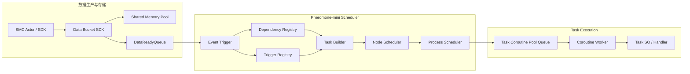

# 第一部分：总体设计（第 1～3 章）

## 第 1 章 项目背景与需求分析

### 1.1 项目背景

本项目面向 SMC Actor 驱动的任务流水线。上游 Actor 接收外部消息，通过 SDK 将中间数据写入节点共享内存；当数据写入成功后，Data SDK 发布数据就绪事件；Event Trigger 根据预先注入的规则判断是否触发 Task；触发后还原目标 Task 的执行信息，并经三级调度送入 Task Coroutine Pool。

本项目负责的是调度和 Trigger 能力，不负责业务 Actor、共享内存池实现或 Task 协程执行器内部实现。

### 1.2 业务流程与模块边界

| 步骤 | 业务动作 | 责任模块 | 本模块需要的契约 |
|---|---|---|---|
| ① | SMC Actor 处理外部消息并调用 SDK 写数据 | SMC Actor / SDK | 提供 source_function、session 等上下文 |
| ② | Data SDK 将数据写入共享内存 | Data Bucket SDK | 写入成功后生成稳定 DataRef |
| ③ | SDK 通知数据写入事件 | Data Bucket SDK / DataReadyQueue | 发布 DataReadyEvent；保证数据先可见、事件后可见 |
| ④ | Event Trigger 匹配规则，还原 Task 并发送 Router | Event Trigger / Task Builder | 规则配置、Function 元信息、TaskDescriptor |
| ⑤ | Router 做资源准入，向协程池投递并尝试唤醒 | Node / Process Scheduler / Task Pool Adapter | 节点、进程容量和 Task Pool 提交接口 |
| ⑥ | 被唤醒的协程取出 Task 并加载执行 | Task Coroutine Pool | Task ABI、SO 路径、Handler 和输入 DataRef |

注意：步骤 ③ 的共享内存消息队列是 DataReadyQueue，步骤 ⑤ 的任务队列是 Task Coroutine Pool 内部 TaskQueue。二者用途、数据结构、消费者和生命周期完全不同。

### 1.3 本模块职责及研发边界

本模块负责：

- 读取并校验 app.json、func.json。
- 建立 Function、DIRECT Dependency、Bucket Trigger 三类 Registry。
- 消费 DataReadyEvent。
- 按 DIRECT 或 Bucket ImmediateTrigger 路径生成 TaskAction。
- 从 Registry 和 DataRef 还原 TaskDescriptor。
- 完成节点级、进程级调度，并调用线程/协程级 Task Pool 接口。
- 管理事件、Task 和 DataRef 的引用所有权。
- 输出可追踪的调度日志、指标和错误码。

本模块不负责：

- 共享内存池、对象分配器、Data Bucket 内部索引和 DataReadyQueue 的底层实现。
- SMC Actor 的消息协议和业务逻辑。
- Task Coroutine Pool 的协程调度算法、工作线程实现和内部队列实现。
- Task SO 的业务代码。
- 跨节点数据复制协议；只定义 DataRef 的远程可解析要求和 Node Scheduler 的路由约束。

### 1.4 功能需求

- 启动时从配置加载函数、依赖、Bucket 和 Trigger。
- 数据写入成功后，事件能够被 Event Trigger 消费。
- DIRECT 依赖支持源函数到一个或多个目标函数。
- ImmediateTrigger 在 Bucket 中每个成功写入对象到达时立即触发。
- 同一事件可以根据不同 Trigger 规则生成多个 Task，但每个 event_id + rule_id + target_function 组合只能被本进程接受一次。
- TaskDescriptor 必须包含执行目标、SO 路径、Handler、输入 DataRef、Session 和资源信息。
- 节点级和进程级调度必须检查资源准入。
- Task Pool 队列满或停止时必须返回错误并正确释放 DataRef。
- 支持启动、停止、异常退出和资源清理。

### 1.5 非功能需求

| 类别 | 要求 |
|---|---|
| 性能 | 触发热路径只处理元数据和 DataRef，不复制业务 Payload |
| 并发 | 支持多个 Actor/SDK 生产者并发发布事件 |
| 正确性 | 只有成功 Commit 的数据可以触发 Task |
| 生命周期 | Task 完成前 DataRef 对应对象不得被回收 |
| 可观测性 | Event、Task、Trigger、Node、PID 可关联 |
| 可扩展性 | Trigger 类型和调度策略可通过接口扩展 |
| 可移植性 | 核心逻辑使用 C11，平台相关能力收敛在 Adapter |
| 可测试性 | Data SDK、Node Scheduler、Task Pool 均可 Mock |

不在缺乏硬件和压测基线时承诺具体微秒级 SLA；先建立端到端延迟基线，再由项目评审确定目标。

### 1.6 本期不实现的能力

- ByName、BySet、ByBatchSize、ByTime、DynamicGroup、Redundant 等 Trigger Primitive。
- 动态增删 Bucket/Trigger 的控制面 API。
- 跨节点 exactly-once、持久化事件日志和分布式事务。
- Task 的业务重试策略和失败补偿编排；本期只返回清晰的接收/失败结果。
- Data Bucket 内部内存池和消息队列实现。
- Task Coroutine Pool 内部协程实现。

### 1.7 术语

| 术语 | 定义 |
|---|---|
| Node | 一个调度节点，拥有本机共享内存和多个进程 |
| Process | 节点上的一个 Scheduler/Task Pool 进程实例 |
| Coroutine | Task Coroutine Pool 中执行 Task 的协程 |
| Data Bucket | 按 Bucket、Key、Session 组织的共享数据命名空间 |
| DataRef | 指向共享数据对象的可校验引用，不是裸指针 |
| DataReadyEvent | Data SDK 在数据 Commit 后发布的就绪事件 |
| DIRECT | 源函数到目标函数的显式依赖边 |
| ImmediateTrigger | 每次匹配的 Bucket 数据写入事件立即触发 |
| TaskAction | Trigger/Dependency 判断后形成的待执行动作 |
| TaskDescriptor | 可投递给 Task Coroutine Pool 的完整任务描述 |
| Task Pool | 下游协程池，拥有 TaskQueue 和工作协程 |

## 第 2 章 Pheromone 源码参考与设计继承

### 2.1 Pheromone 两级调度架构

Pheromone 的总体思想是 Coordinator + Local Scheduler：

- Coordinator 维护节点状态、应用注册、函数依赖和 Bucket/Trigger 元信息，并在全局范围选择 Worker Node。
- Local Scheduler 维护本机 Executor 状态、函数缓存和本地 Trigger/Dependency 视图，优先使用可复用的 Warm Executor，再选择可用 Cold Executor。
- Executor 执行函数并通过共享内存对象接口发布输出。

Pheromone 不是本项目的三级调度实现。本项目将 Local Scheduler 的本地执行资源选择进一步拆成进程级和线程/协程级。

### 2.2 Data Bucket 数据组织机制

Pheromone 用 Bucket、Key、Session 组成逻辑数据标识。Bucket 用于数据命名空间，Key 标识对象，Session 区分一次流水线执行。Local Scheduler 根据 BucketKey 找到共享内存对象和数据地址；Coordinator 维护对象地址和节点位置，以支持数据位置感知的全局调度。

本项目继承 Bucket + Key + Session 的逻辑标识，但 DataRef 采用稳定句柄、Region、Offset、Length、Generation 和 OwnerNode 等字段，不允许将进程内裸指针作为跨进程协议。

### 2.3 DIRECT 依赖机制

Pheromone 的 AppRegistration 中包含 DataDependency。DIRECT 依赖在 Coordinator 注册时保留为依赖关系，并下发给 Local Scheduler；Local Scheduler 收到源函数输出后，直接查 source_function 对应的目标函数集合。若调用方指定目标函数，则校验目标是否属于预注册依赖；未指定目标时，对所有下游目标分发。

DIRECT 不是 Bucket Trigger。Pheromone 的代码在 DIRECT 源函数存在依赖时先走 DIRECT 分支，否则才进入普通 Bucket Trigger 分支。因此本方案规定 DIRECT 路径优先，并对配置冲突做启动校验。

### 2.4 ImmediateTrigger 实现机制

Pheromone 的 ImmediateTrigger 在每个新对象到达时返回一个 TriggerAction，目标为配置中的函数，输入为当前对象的 Session + Key。它不等待多个 Key、不维护批次计数，也不要求定时器。

本项目保留该语义：当 DataReadyEvent 的 Bucket 命中已启用的 ImmediateTrigger 时，为该规则生成一个 TaskAction。

### 2.5 Pheromone 其他 Trigger 能力（仅调研，不实现）

- ByName：Key 等于指定名称才触发。
- ByBatchSize：累计达到指定数量后触发。
- BySet：指定 Key 集合全部到齐后触发。
- DynamicGroup：根据控制组和数据组动态聚合。
- Redundant：按 K/N 冗余完成策略触发。
- ByTime：在数据到达时检查时间窗口。

这些能力说明 Pheromone 的 Trigger 是可扩展的 Primitive 抽象，但本项目当前明确只实现 ImmediateTrigger。不能因源码存在这些类型，就把它们纳入 V0.3 P0。

### 2.6 Task 信息还原机制

Pheromone 的 TriggerAction 包含目标函数和一个或多个 Session + Key。Local Scheduler 根据 Trigger Option 和本地缓存情况构造函数参数；若数据值已缓存可直接传值，否则传对象标识、长度和地址信息。随后将内部函数调用交给调度逻辑。

本项目不传输 Payload，而是把 DataRef、BucketKey 和 InputMode 写入 TaskDescriptor，由 Task Pool/Task SDK 在执行时按 DataRef 读取。

### 2.7 Local Scheduler 任务分发机制

Pheromone 的 Local Scheduler 维护 Executor 状态和函数缓存，优先选择已加载目标函数且空闲的 Warm Executor；否则选择空闲 Cold Executor。没有本地 Executor 时，按配置延迟、拒绝或转发到全局路径。

本项目进程级调度沿用 Warm Process 优先思想；线程级不自行实现工作协程选择，而调用 Task Pool 的入队和唤醒接口。

### 2.8 Pheromone 与本项目能力映射

| Pheromone | 本项目 | 继承/变化 |
|---|---|---|
| Coordinator | Node Scheduler | 节点状态、数据位置、全局容量选择 |
| Local Scheduler | Process Scheduler | 本地进程选择和 Warm 优先 |
| Executor 状态 | Process/Pool Capacity | 按进程可接收容量和协程池队列准入表示 |
| BucketKey | Bucket + Key + Session | 保留逻辑命名 |
| TriggerAction | TaskAction | 保留“目标 + 输入对象引用”语义 |
| ImmediateTrigger | ImmediateTrigger | 语义保持 |
| DIRECT Dependency | Dependency Registry | 单独路径，不转换为 Trigger |
| Executor | Task Coroutine Pool | 由线程/协程池负责执行 |

### 2.9 源码复用、裁剪及差异

- 复用的是行为语义、路由顺序和数据驱动思想，不直接复用 Pheromone 的 C++ 类代码。
- 本项目用 C11 结构体、函数指针/枚举分派实现模块；Trigger 只有 ImmediateTrigger 时不需要完整 C++ 虚函数层次。
- Pheromone 支持多种 Trigger，本项目仅 ImmediateTrigger。
- Pheromone 使用 Coordinator + Local Scheduler 两级；本项目把本地层拆成 Process + Thread/Coroutine。
- Pheromone 的共享内存对象命名和 IPC 细节由其运行时实现；本项目通过 Data SDK 的 DataRef 契约隔离底层实现。

## 第 3 章 总体软件架构

### 3.1 系统整体架构

### 3.2 Node、Process、Coroutine 部署架构

- Node Scheduler 可作为集群级服务，也可在单节点 Demo 中以本地实现替代。
- 每个 Node 上可以运行一个或多个 Scheduler/Task Pool Process。
- 每个 Process 持有自己的 Function/Dependency/Trigger Registry 只读快照，并连接本进程 Task Coroutine Pool。
- Task Coroutine Pool 内部拥有一个或多个工作线程及协程队列；这些内部结构不属于 Scheduler 设计范围。
- Data Bucket 的共享内存对象位于 Node 范围；跨进程访问通过 DataRef 和 Data SDK 完成。

### 3.3 模块划分

见主文档“软件模块”表。核心调用方向为 Config Loader → Registry；DataReadyQueue → Event Trigger；Event Trigger → Task Builder → Node Scheduler → Process Scheduler → Task Pool Adapter。

### 3.4 模块职责与调用关系

Registry 在初始化后只读。Event Trigger 不直接访问 Task Pool 内部队列，只调用 Task Router。Task Builder 不进行节点选择。Node Scheduler 不读取共享内存 Payload，只使用 DataRef 的位置元信息。Process Scheduler 不加载 SO。

### 3.5 控制流与数据流

控制流：配置注入 → Registry 构建 → DataReadyEvent 消费 → 路由判断 → TaskAction → TaskDescriptor → 三级调度 → Pool 接收。

数据流：Payload 由 Data SDK 写入共享内存；DataReadyEvent 仅携带 DataRef 和元数据；TaskDescriptor 携带 DataRef；Task Handler 在执行时通过 Data SDK 读取数据。Scheduler 不成为数据中转站。

### 3.6 系统初始化及销毁流程

初始化顺序：
1. 解析配置并校验 schema_version。
2. 构建 Function Registry、Dependency Registry、Trigger Registry。
3. 校验引用关系、SO 文件路径和调度策略。
4. 初始化 Data SDK Adapter、Task Pool Adapter。
5. 注册本进程状态到 Node Scheduler。
6. 启动 DataReadyQueue 消费线程。
7. 进入 Ready 状态。

销毁顺序：
1. 将 Scheduler 状态切换为 STOPPING，拒绝新事件。
2. 停止消费 DataReadyQueue，并等待正在处理的事件退出。
3. 等待或取消未投递的 TaskAction。
4. 对未成功转移所有权的 TaskDescriptor 释放 DataRef。
5. 注销进程状态、释放 Registry 和 Adapter。
6. Task Pool 的退出由其所有者负责；Scheduler 不擅自销毁下游线程。

### 3.7 Task 完整生命周期

CREATED → ROUTING → NODE_SELECTED → PROCESS_SELECTED → QUEUED → RUNNING → SUCCEEDED / FAILED / CANCELLED。

Scheduler 负责 CREATED 到 QUEUED 的主要状态迁移；RUNNING 之后由 Task Coroutine Pool 回报状态。队列接收成功不等于任务执行成功。

### 3.8 上下游系统职责划分

- 上游 Data SDK：保证数据 Commit 后发布事件；提供 DataRef 校验、retain、release。
- Scheduler：匹配规则、构建任务、三级路由、资源准入和可观测性。
- 下游 Task Coroutine Pool：保证入队原子性、队列满反馈、工作协程唤醒、SO 加载和 Handler 调用。
- Node Scheduler 服务：维护节点状态、选择目标节点并处理远程路由；若节点选择服务由其他团队提供，本模块只实现 Client Adapter。
