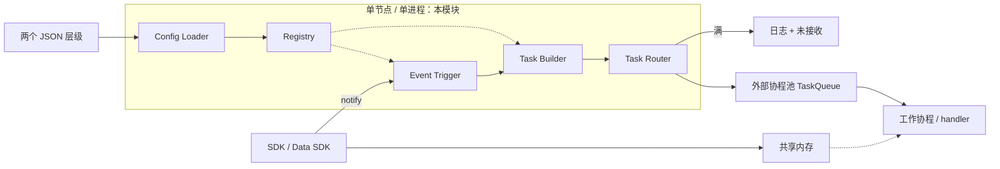
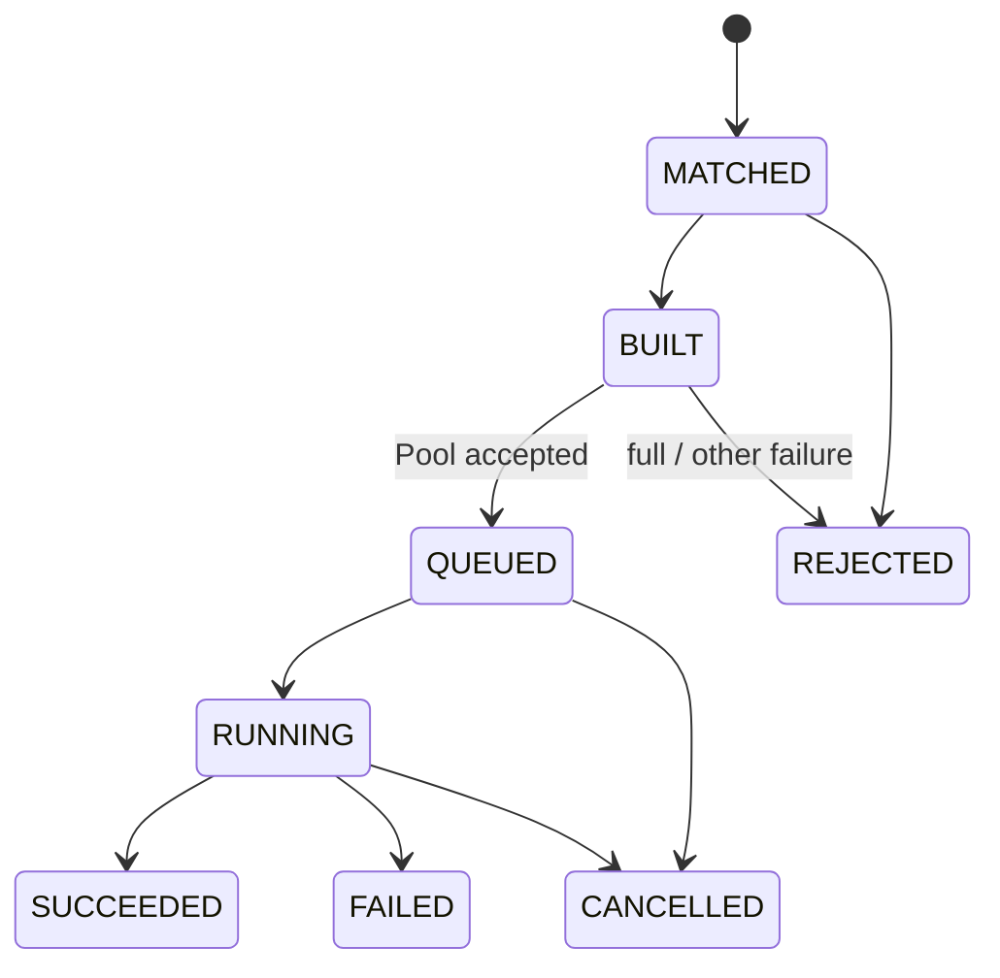

# 第一部分：总体设计（第 1～3 章）

[返回主文档](V0.4-完整软件设计方案.md)

## 第 1 章 项目背景与需求分析

### 1.1 背景与业务流程

SMC Actor 接外部消息后使用 SDK 写数据，Data SDK 负责共享内存，数据就绪驱动任务执行。当前预研只负责 3、4、5 三步。

| 步骤 | 行为 | 责任 |
|---|---|---|
| 1 | SMC Actor 处理消息、调用 SDK | 上游 |
| 2 | Data SDK 写共享内存并确认成功 | 上游 |
| 3 | SDK 通知 Event Trigger；规则匹配 | SDK + 本模块 |
| 4 | Task Builder 还原 Task，交给 Task Router | 本模块 |
| 5 | 本进程资源准入、Task 入队并尝试唤醒一个协程；队列满仅日志 | 本模块调用下游 |
| 6 | 被唤醒的协程取 Task、加载执行 | 协程池团队 |

### 1.2 研发边界

本模块提供 Config Loader、Registry（Function/Dependency/Trigger）、Event Trigger（含 Task Builder）、Task Router 四个顶层模块。Task Builder 独立设计但归属 Event Trigger。Task Pool Adapter 归属 Router；DataRef 调用为 SDK 接口适配。

不实现共享内存分配、Bucket 内部索引、数据事件队列底层、任务队列、协程调度、SO 加载、业务执行。SDK 有队列时可通过 SDK 消费端调用 notify；不是本模块必选架构。

### 1.3 功能需求

配置注册函数、资源、依赖、Bucket、两种 Trigger；成功写事件判断 DIRECT 或 Bucket 规则，构建完整 TaskDescriptor；调用本进程 Pool 原子提交；满队列记录分发日志并报告未入队；明确事件结果和数据引用生命周期。详见第 19 章。

### 1.4 非功能需求

热路径不解析 JSON、不复制业务数据、不加载 SO；注册表只读并支持并发查询；每个匹配规则或 DIRECT 目标独立生成 Task；队列满不阻塞、不等待执行、不自动跨进程投递；失败返回且无引用泄漏。延迟目标待实测，不虚构 SLA。

### 1.5 本期不实现

跨节点和跨进程分发、独立执行实例选择、负载均衡、资源心跳、动态规则增删、聚合 Trigger、定时器、自动重试、持久化日志、强制 CPU/GPU/内存配额与任务取消。队列满仅预留日志分支。有界事件去重 P1，不纳入 P0 验收。

### 1.6 术语

| 名称 | 含义 |
|---|---|
| Function | 静态函数配置，name 是含 .so 的文件名 |
| Task | 一次具体函数执行 |
| Bucket / Key / Session | 数据命名空间、对象键、业务运行上下文 |
| DataRef | SDK 管理的对象引用，不是 Scheduler 复制的业务 Payload |
| DIRECT | 显式源函数到目标函数的依赖边 |
| Primitive | Bucket 数据到达的匹配条件，本期两种 |
| TaskAction | 规则命中后的目标及事件关联 |
| TaskDescriptor | 下游可执行的完整描述信息 |
| TaskQueue | 协程池拥有的任务队列 |

## 第 2 章 Pheromone 源码参考与设计继承

### 2.1 原项目参考

固定 commit 4d22677aa20dd94069da06d47ec2608504bf6bf4。原项目 Coordinator + Local Scheduler 为两级分布式调度；本期只复用数据驱动和本地优先的思想，不移植其分布式执行资源选择机制。完整源码证据见附录 A。

### 2.2 Data Bucket

原项目通过 Bucket、Key、Session 定位共享内存对象，Executor 的函数库创建、写入并发送对象。小对象也可能走消息打包。V0.4 保留逻辑字段，所有任务统一传 DataRef；SDK 的实际引用表示由接口冻结确定，不复制源项目命名拼接及小数据打包。

### 2.3 DIRECT

原项目 app_register_handler 保留 DIRECT，comm_helper 维护源到目标集合。scheduler_server 在临时输出对象到达时先检查源函数是否存在 DIRECT，目标空则 fan-out，非空则验证依赖。只有不走 DIRECT 且非保留 direct_invoc Bucket 时才检查 Trigger。V0.4 保留该优先级，明确非法显式目标错误。原项目只取每个依赖首个源，V0.4 为保留数组格式采用源×目标独立边展开，明确不是多源汇聚。

### 2.4 Immediate / ByName

Immediate 每个数据到达产生一条 Action；ByName 精确比较 key_name，匹配才产生 Action。两者均不维护数据聚合状态。原项目的重跑缓存不是必需，本期裁剪。

### 2.5 Task 信息还原与本地分发

原项目 check_object_arrival 生成目标函数及参数元信息，schedule_func_call 按本地执行资源选择；本期按 Registry 还原 SO、handler、资源、输入 DataRef，并提交统一的本地池。原项目的 Trigger Option 是业务参数模式，不照搬其 arg_flag 内部编码。

### 2.6 能力映射

| 原项目 | V0.4 |
|---|---|
| AppRegistration、DataDependency | app.json + Dependency Registry |
| TriggerEntity、Bucket→Trigger | JSON primitive + Trigger Registry |
| ImmediateTrigger、ByNameTrigger | C 无状态匹配函数 |
| TriggerAction / FunctionMetadata | TaskAction / TaskDescriptor |
| Local Scheduler 的本地优先 | Task Router 的统一池提交 |
| 全局选择、其他 Primitive、重跑 | 不纳入本期 |

## 第 3 章 总体软件架构

### 3.1 架构与部署

### 3.2 控制流与数据流

控制流：配置解析 → 只读注册表 → notify → DIRECT 或 Bucket → Action → 描述符 → try_submit。数据流：SDK 写数据、提交后引用有效 → 描述符携带引用 → 下游在执行时映射读取。数据流不绕经 Scheduler，不扫描 Bucket。

### 3.3 模块关系

Config Loader 完成全部校验后一次发布 Registry。Event Trigger 访问依赖和触发表，Task Builder 查函数表；Router 只使用描述符和池接口，完全不需要识别具体协程或 SO 的加载状态。

### 3.4 初始化与销毁

SDK 和池适配接口可用后 init；解析配置、构建索引、全部成功后发布 engine；SDK 才能注册/调用 notify。退出时先停止外部通知并等待在途 notify 全部结束，再 destroy engine；已入队任务由池继续执行或取消，SDK 引用服务必须存活到池释放完所有引用。不得在 handler 内销毁当前 engine。

### 3.5 Task 生命周期

本模块到 QUEUED 为止；执行状态由下游管理。未匹配不产生 Task。队列满不创建跨进程任务，不算投递成功。
