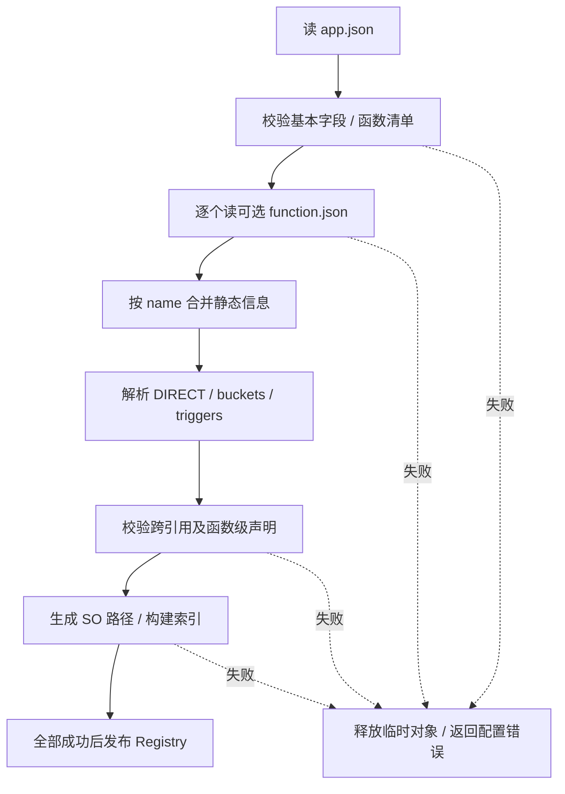
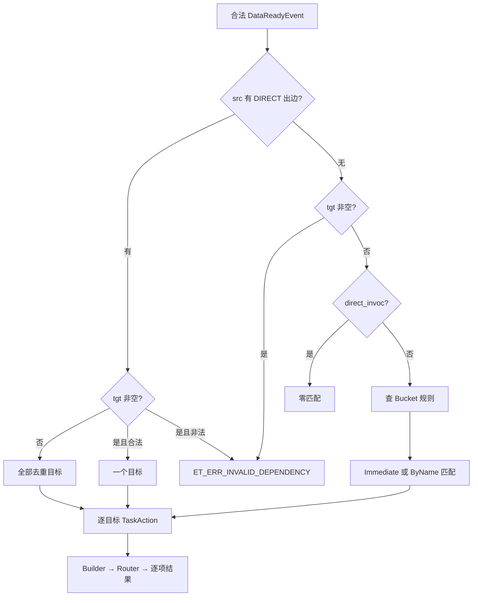
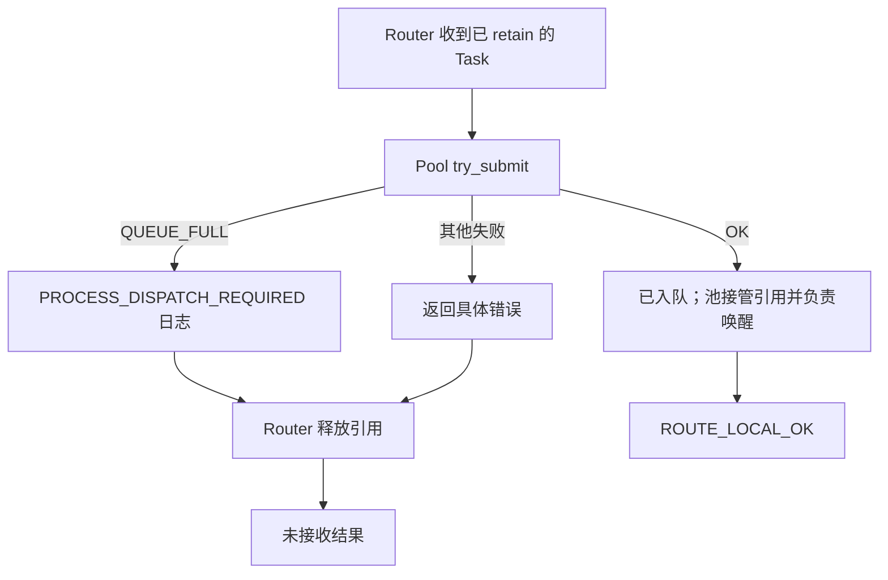

# 第二部分：核心模块详细设计（第 4～10 章）

[返回主文档](V0.4-完整软件设计方案.md) · [公共 C 接口](appendix/C-C接口与Task-ABI.md)

## 第 4 章 Task 定义与执行规范

### 4.1 Function 与 Task

Function 是配置中静态的 SO 执行单元；Task 是一次执行实例。一个 Function 可被多次触发，同一事件也可生成多个目标 Task。Task ID 与 Event ID 不等同。每个 Task 当前只有一个输入对象，无多输入汇聚。

### 4.2 SO 部署与入口

Function 的 name 即 SO 文件名（例如 producer.so、processor.so）；由 Config Loader 生成绝对路径 /dev/shm/tasks/producer.so，不接受自定义目录、路径穿越或额外拼接 .so。入口始终为 handler，JSON 不需要重复配置；若未来允许显式 entry，只能为 handler（当前不新增字段）。同名文件不可在运行时原地替换；升级停机后替换并重启。部署团队负责目录权限、可信 SO 来源、架构/依赖一致性。

Linux 的 /dev/shm 可能挂载 noexec，导致 dlopen 映射可执行段失败。固定路径仍遵守需求，部署前由环境负责人检查挂载策略（findmnt -T /dev/shm/tasks），确认允许合法 SO 加载；本模块不改挂载权限，不自行改路径。Pool 在实际加载时检查文件和符号。

### 4.3 无状态、重入与 ABI

每个 SO 导出 int handler(const task_context_t *ctx)，此为待双方冻结的推荐 C ABI，非 Pheromone 原始 handle ABI。任务不得依赖前一次任务、固定协程或可变全局变量；栈变量和显式 SDK 数据为主要状态来源。共享只读常量允许；外部副作用由业务控制，不能假设任务具有 exactly-once 执行语义。任务不自行释放池持有的数据引用，不长期保存 ctx 或映射指针。若协程会迁移，不将线程局部变量作为任务上下文。

### 4.4 输入输出与资源

TaskContext 提供当前 app、session、function、task ID，及按 input_mode 暴露的 key/只读 value；数据由下游 Data SDK 映射并在 handler 返回后解映射。输出通过 SDK 先 Commit 再 notify，继承 session 并由执行上下文注入 source_function；不以 handler 返回作为 DIRECT 触发条件。Resource 和 Execution 由 JSON 完整还原为元信息。当前不实现 CPU/GPU 配额、线程绑定、优先级队列、超时强杀或复用策略。

### 4.5 业务示例、编译和部署

见[附录 C](appendix/C-C接口与Task-ABI.md)与 examples 下的头文件、producer.c、processor.c。每个 SO 独立编译且只导出同名 handler；由下游使用固定路径加载。测试中使用 Mock，不在 Scheduler 内实现 dlopen 或协程池。

## 第 5 章 JSON 配置协议设计

### 5.1 配置组织与原始协议

完整保留原始附件两种 JSON 的字段及层级：
- app.json：应用级，app_name、description、version、functions[]、dependencies[]、triggers[]、buckets[]。
- function.json：可选单函数对象（附件原名 func.json；本版采用用户确认的 function.json 名称），包含 name、description、version、resource、execution、dependencies、triggers。一个文件仅描述一个函数；多函数可由调用者显式传入多个文件路径（实际文件名不参与关联）。
- 无 scheduler、node_policy、process_policy、function_id 等替代结构；不强制引入 schema_version。
- app.json 必须完整提供函数清单和基本资源；不需要每个函数都另建 function.json。

附件原样例和实际可联调示例见[附录 B](appendix/B-JSON配置协议示例.md)。原始附件是两个 JSON 对象与说明文字拼在一起，不是单个合法 JSON 文件。

### 5.2 app.json 字段

| 路径 | 类型 | 约束 |
|---|---|---|
| app_name | string | 必填，非空，单 engine 对应一个应用 |
| description / version | string | description 可空/省略，version 必填非空，应用业务版本而非设计版本 |
| functions | array(object) | 至少一个；name 唯一 |
| functions[].name | string | 含 .so 的安全文件名 |
| functions[].description | string | 可选 |
| functions[].resource | object | cpu_cores、memory_mb、timeout_ms 必填 |
| dependencies | array(object) | 必填，可为空；只接受 DIRECT |
| dependencies[].src_functions / tgt_functions | array(string) | 非空；每个成员必须为已注册函数 |
| triggers | array(object) | 必填，可为空 |
| triggers[].bucket / trigger_name | string | 必填，Bucket 已声明；同 Bucket 内 trigger_name 唯一 |
| triggers[].primitive_type | string | IMMEDIATE 或 BY_NAME |
| triggers[].primitive | object | function 必填；BY_NAME 另需 key_name |
| triggers[].trigger_option | integer | 0/1/2，省略默认 0 |
| buckets | array(string) | 必填，可为空；普通 Bucket 名唯一；direct_invoc 保留且不得配置 |

配置中的字符串比较区分大小写；不使用 Key 前缀、模糊匹配或正则。

### 5.3 function.json 字段

| 路径 | 类型 | 处理 |
|---|---|---|
| name | string | 与 app.functions[].name 精确匹配 |
| description / version | string | 可选；覆盖描述；函数 version 缺失时取应用 version |
| resource.cpu_cores / memory_mb / timeout_ms | number / integer / integer | 提供则逐字段覆盖 |
| resource.gpu.required / device_count / memory_mb | bool / integer / integer | GPU 需求元数据，默认 false/0/0 |
| resource.disk_mb / network_mbps | integer | 默认 0 |
| execution.type | string | 保留附件 thread，作为元数据，不改变协程执行方式；缺省未指定 |
| execution.priority / affinity / max_concurrency / reuse | integer / array(integer) / integer / bool | 默认 0/[]/0（未指定）/false；只传递元信息 |
| dependencies.produces_to / depends_on | array(string) | 可选，存在则验证与 app DIRECT 出边/入边集合一致 |
| triggers.listen_buckets | array(string) | 可选，存在则验证与 app 中指向此函数的 Bucket 集合一致 |
| triggers.conditions | array | 缺省或空数组；非空语义本期未定义，拒绝启动，不静默忽略 |

资源以原字段单位保留：CPU cores 可为小数；memory_mb、gpu.memory_mb、disk_mb、network_mbps 为非负整数（基础 memory_mb、timeout_ms 必须正数）；cpu_cores 必须有限且正数。GPU required=false 时 device_count/memory_mb 必须为 0，true 时 device_count>0。priority 用 int32_t，affinity 非负 CPU 编号无重复，max_concurrency 显式值必须正数。边界及整数精度见第 6 章。

### 5.4 DIRECT 配置

保持 src_functions、tgt_functions 两个数组。每个源与每个目标组合为独立边；重复边合并，目标顺序以首次出现为准；多源不代表等待所有源。配置支持链式、一对一、一对多；本期不检测循环导致的无限业务产出，由应用设计保证终止，不自动阻断合法循环。

### 5.5 Bucket 与 Trigger 配置

buckets 是逻辑 Bucket 字符串清单，不负责创建物理共享内存。SDK 应在接入前准备相应命名空间；direct_invoc 是参考源码保留的内部 DIRECT 名称，由 SDK 双方约定，普通规则禁止监听。

IMMEDIATE 的 primitive 仅含 function；BY_NAME 的 primitive 含 function、key_name。两者可同 Bucket 并存；规则按 app.json 顺序匹配。DIRECT 不放入 triggers 数组。

### 5.6 Trigger Option

| 数值 | 模式 | Handler 参数 |
|---:|---|---|
| 0 | INPUT_VALUE | 只读 value + 长度 |
| 1 | INPUT_KEY_VALUE | key + 只读 value + 长度 |
| 2 | INPUT_KEY_ONLY | key，不提供 value，长度 0 |

描述符始终保留 Bucket、Key、Session、DataRef 和真实长度用于定位与生命周期；模式 2 不要求映射输入数据，不构成安全隔离。DIRECT 固定 0。Pheromone 的 trigger_option + 1 与小对象 arg_flag 特例不移植。

### 5.7 合并、覆盖与默认值

先读 app，再逐个读显式传入的 function.json；未知 name、同名多个补充文件、错误字段类型均失败。description/version/resource/execution 属于静态元数据，可按上述规则补充，resource.gpu 按成员合并后校验；数组 affinity 整体替换。缺省不覆盖。app 是依赖与 Trigger 的唯一权威，函数级相应描述只做集合一致性检查（缺省不检查）。不根据 function.json 自动注册新函数、隐式新增边或规则。所有校验在初始化完成前执行。

## 第 6 章 Config Loader 模块详细设计

### 6.1 职责与内部组织

负责文件读取、cJSON 解析、字段类型与长度检查、默认值合并、交叉引用验证、只读索引构建。临时 config_model 解析完整后移交 Registry；失败时释放全部临时对象，输出文件名、JSON 路径、错误原因，不发布半成品。

### 6.2 加载流程



### 6.3 校验与边界

- 所有 JSON 对象拒绝重复字段、未知字段、类型错误、尾随非空白内容；JSON 文件上限建议 1 MiB，函数/规则/边/路径列表上限由编译常量或调用方约束（建议每类 4096），超过则拒绝而非截断。
- 名称、key、session、version 上限见公共头文件（字节含 NUL）；配置解析须先校验 NUL 与长度，再复制。UTF-8 描述可用；SO name 仅 ASCII 字母数字、点、下划线、短横线，首字符字母数字或下划线，末尾 .so，禁止 ..、斜线和反斜线。
- 数值必须有限、整数型字段不得有小数，转换前检查范围；cJSON 数字为 double，整数超过 2^53-1 拒绝，避免精度损失。超时用 uint32_t，其他数值对应公共类型。
- 依赖端点、Trigger 目标必须存在；普通 Bucket 必须已声明；trigger_option 合法，primitive 必需字段正确，IMMEDIATE 不接收 key_name，BY_NAME key_name 非空。
- app 与 function 的依赖/监听描述若同时存在则按集合验证；先展开边后验证。DIRECT 源输出和普通 Bucket 规则可以同时存在，不因配置共存而拒绝；运行时优先级明确，不能假定所有同名 Bucket 都来自同一源。
- SO 文件存在及可读性为部署预检，可由集成测试执行；不要求在纯配置单测中实际加载 SO，不在 Scheduler 中调用 dlsym。

### 6.4 C 接口与实现边界

event_trigger_init 接收 app_path、function_paths[]、数量、适配器及输出 engine；内部调用 config_load → registry_build。用 cJSON_ParseWithLengthOpts（要求完整输入）或等价解析实现，遍历字段检测重复；仅复制已验证的值。静态资源及执行信息存储于 function_config_t。配置错误一律返回 ET_ERR_CONFIG，分配失败 ET_ERR_NO_MEMORY；diagnostic 可用日志/调用者错误缓冲区记录。示例接口详见附录 C，加载算法为设计而非现成实现。

## 第 7 章 Registry 模块详细设计

### 7.1 组织方式

一个 engine 对应一个 app，所有 Registry 以该 app 为隐式作用域，避免不同 app 同名冲突；事件 app_name 必须相等。启动构建索引，Ready 后只读，销毁由 engine 负责。

| Registry | Key | Value |
|---|---|---|
| Function Registry | name | function_config_t（含 so_path、entry、resource、execution） |
| Dependency Registry | src_function | 去重、有序目标函数索引数组 |
| Bucket Registry（Trigger Registry 内部） | bucket | 已声明标记、有序 Trigger 列表 |

### 7.2 Function Registry

按 name 查配置；引用在初始化时可预解析为稳定索引，避免热路径重复字符串哈希。函数条目包含描述（配置侧保留）、版本、路径、入口、资源和执行配置。Task Builder 复制运行时所需的全部字段，不保留 Registry 指针。查询失败视为配置/内部错误。

### 7.3 Dependency Registry

读取 src_functions×tgt_functions，按源建邻接表，每个源的目标唯一。find 返回只读 span（无匹配 count=0 为正常）；contains 用目标索引或遍历验证。无需依赖执行状态、计数器、拓扑调度器。

### 7.4 Trigger Registry

Bucket 查规则列表；规则记录 trigger_name、primitive_type、target function 索引、option、ByName key_name。注册时预解析 primitive。无规则的已声明 Bucket 可正常接收事件并返回零匹配；未知 Bucket 校验失败（direct_invoc 特殊处理）。同一函数可由同 Bucket 不同规则分别触发。

### 7.5 内存与并发

建议 P0 用排序索引或哈希 + 连续数组；无需运行期加写锁。可用线性查询作为正确性基线，性能数据证明需要时再优化。临时索引失败清理；停止所有 notify 后释放。SO 执行和池内 Task 不引用 Registry，因此 engine 销毁不影响已接收 Task。

### 7.6 内部 C 接口（设计）

```c
const function_config_t *function_registry_find(const registry_t *, const char *name);
int dependency_registry_find(const registry_t *, const char *src,
                             const function_config_t *const **targets, size_t *n);
bool dependency_registry_contains(const registry_t *, const char *src, const char *target);
int trigger_registry_find(const registry_t *, const char *bucket,
                          const trigger_config_t **rules, size_t *n);
```

registry_t、trigger_config_t 为私有类型；返回数据借用至 engine 销毁，不由调用者释放。普通未命中与内部错误必须区分。

## 第 8 章 Event Trigger 模块详细设计

### 8.1 职责与结构

Event Handler → validate → DIRECT Handler 或 Bucket Primitive → TaskAction → Task Builder → Task Router。唯一匹配点；不访问 Payload、不扫描共享内存、不另起线程或事件队列、不执行任务。notify 由 SDK 在写成功后调用，可在不同线程并发执行。

### 8.2 DataReadyEvent

包含 event_id、app_name、bucket、key、session_id、src_function、tgt_function、object_version、data_size、data_ref。API 只接受已 Commit 事件；SDK 保证可见性和引用有效。外部 Actor 的 src_function 为空；Task 的 SDK 从当前 TaskContext 获得源函数。tgt_function 为空表示未指定。event_id 由 SDK 唯一生成，用于关联及 P1 去重；相同 key 的两次真实写入应使用不同 event_id，object_version 或 DataRef 区分对象版本。

### 8.3 校验与分支

event_id 非零；app 匹配；所有必要字符串有 NUL 且非空；源非空必须已注册，目标非空必须是合法依赖目标；普通 Bucket 已声明。SDK validate 检查引用、对象版本与长度；SDK 持有基础引用直到 notify 返回。零字节对象是否支持由 SDK 冻结（本设计不默认拒绝）。没有 DIRECT 的 direct_invoc 事件不匹配普通规则；无显式目标时返回零匹配，显式目标无合法边返回错误。



### 8.4 DIRECT Handler

按源函数的边集决定分发，而不是新增第三种 Primitive。空目标 fan-out 全部；显式目标只生成一个 Action；非法目标返回 ET_ERR_INVALID_DEPENDENCY，不进入 Bucket 分支。每次成功写入事件可触发一次每目标 Action，不等待源函数结束。即使 source 写入的普通 Bucket 也存在 Trigger，DIRECT 优先；这在 Pheromone 源码中是源函数级行为。

### 8.5 ImmediateTrigger

对于命中 Bucket 的每个 IMMEDIATE 规则，生成一个 Action，target 为 primitive.function，输入为本次对象。不同 event_id 逐次触发；无需数据状态缓存。

### 8.6 ByNameTrigger

仅当 event.key 与 primitive.key_name 完全相等时生成 Action，否则零匹配。比较原始 key，不拼接 session，不支持前缀、正则或集合等待。Session 原样传递给 Task。

### 8.7 C 语言核心匹配

```c
static bool primitive_match(const trigger_config_t *r,
                            const data_ready_event_t *e)
{
    switch (r->type) {
    case TRIGGER_IMMEDIATE:
        return true;
    case TRIGGER_BY_NAME:
        return strcmp(r->key_name, e->key) == 0;
    default:
        return false; /* 已在启动时拒绝未知类型 */
    }
}
```

调用方先按 Bucket 查询，再执行 primitive_match。DIRECT 路径单独处理。P0 可先扫描一次统计匹配数，再扫描一次逐条构建，避免为 Action 列表分配内存；禁止在统计前投递。

### 8.8 TaskAction、扇出与结果

Action 包含 source_type、目标函数配置引用、trigger_name（DIRECT 为空）、input_mode、借用的 event 指针。生命周期仅限 notify 调用栈。notify 先校验并计算匹配数量，若 result.items 容量不够，返回 ET_ERR_RESULT_CAPACITY、count=所需数量，不生成 Task；调用者可扩容后重试。

逐 Action 构建/投递，保持配置顺序。单项失败记录 build 或 route 错误，继续处理其他项；不撤销已接收 Task。总返回 ET_OK 表示事件处理完成，不代表全部入队；看 result.enqueued/overflow/failed 及 items。合法未命中 ET_OK + matched=0。错误定义见附录 D。

### 8.9 重复事件、并发与最小可靠性

P0 每次合法通知独立匹配；不隐式去重，不自动重试。SDK 不得因部分失败盲目重放整个事件，否则已接收项可能重复；由业务决定补偿，本期不提供单目标重试 API。P1 可选按 event_id+规则/目标保留有界状态，提交前占位、成功提交后确认、失败清除，过期/重启不保证 exactly-once。详见第 15 章。多个 notify 可并发，只读 Registry、原子 task_id 和线程安全 SDK/Pool 接口。

### 8.10 主入口算法（C 风格设计，非完整实现）

```c
int event_trigger_notify(event_trigger_t *engine,
                         const data_ready_event_t *event,
                         trigger_result_t *out)
{
    /* 内部函数：validate → enumerate/count，均无投递副作用 */
    int rc = validate_and_count(engine, event, out);
    if (rc != ET_OK) return rc;
    /* enumerate_again 对每个匹配调用 dispatch_one，汇总逐项状态 */
    enumerate_and_dispatch(engine, event, out);
    return ET_OK;
}
```

validate_and_count 必须重置输出计数、保留 items 与 capacity、验证引用和路由；枚举顺序稳定。dispatch_one 先生成 Task ID，再 build；构建失败写 item 并继续；build 成功后调用 Router，Router 消费本次保留的引用（成功交给池，失败释放）。第 11 章及附录 C 给出公开接口。

## 第 9 章 Task Builder 详细设计

### 9.1 输入与输出

输入 TaskAction（借用 event、Function 配置）和唯一 task_id，输出调用栈上的 task_desc_t。静态信息：app、task_name、so_path、entry、version、resource、execution；动态信息：task_id、event_id、source_type、src_function、trigger_name、session_id、bucket、key、object_version、data_size、data_ref、input_mode。

### 9.2 构建流程

1. 验证 action 与目标配置存在。
2. 零初始化 TaskDescriptor，复制已验证的固定长度字段和静态资源/执行结构。
3. 保留输入对象原始逻辑身份和 DataRef，不复制 Payload。
4. 调用 Data SDK retain，为此 Task 获得独立引用；失败不产生可投递 Task。
5. 返回成功，描述符和引用交由 Router 的本次调用处理。

Task ID 使用进程内原子递增非零 uint64_t，从 1 起；耗尽时返回内部错误而非回绕。重启不保证全局唯一，日志需结合进程运行实例。

### 9.3 资源还原与输入模式

resource/execution 原样复制到 TaskDescriptor（字段和单位见第 5 章）；不存在复杂资源分配器。Pool 按 input_mode 创建 TaskContext。每个 Task 只有一个输入；fan-out N 个任务各 retain 一次。Task 描述符不存任何借用的 Registry 或 event 指针。

### 9.4 核心 C 示例

```c
static int task_builder_build(event_trigger_t *e,
                              const task_action_t *a, uint64_t id,
                              task_desc_t *out)
{
    /* fill_descriptor 检查并复制所有元信息，不持有引用 */
    int rc = fill_descriptor(a, id, out);
    if (rc != ET_OK) return rc;
    if (e->adapters.retain(e->adapters.data_ctx, out->input.data_ref) != 0)
        return ET_ERR_DATA_REF;
    return ET_OK; /* out 拥有一份 retain */
}
```

内部类型定义见附录 D；函数签名和适配器与附录 C 一致。若将来 retain 后还有失败步骤，必须 release 恰好一次；当前将 retain 放在最后以缩短清理路径。

## 第 10 章 Task Router 模块详细设计

### 10.1 职责与策略

输入完整 TaskDescriptor，优先且仅向本进程协程池提交。没有目标节点、目标进程或具体协程的选择逻辑。容量查询若下游提供只能用于诊断，最终由原子 try_submit 决定资源准入；队列满不进行真实进程间分发。

### 10.2 本地资源判断

Pool 的 try_submit(task) 以非阻塞语义执行准入、复制描述符、入队、尝试唤醒。P0 硬条件为队列有容量且池 Ready；忙碌协程不等于资源不足（队列仍可接收）。若真实池还提供资源不足状态，Router 映射为 POOL_UNAVAILABLE；不在本模块重新实现资源配额。

### 10.3 投递、唤醒与满队列



下游可内部拆分 enqueue/wake_one，但 adapter 对 Router 暴露一个明确接收结果的 try_submit。成功入队后无等待协程仍返回 OK；任务保留，池负责避免丢失唤醒。失败必须保证未入队且不持有引用；不能出现已入队又返回失败的歧义。日志不代表实际分发。

### 10.4 C 语言核心逻辑

```c
static route_result_t task_router_dispatch(event_trigger_t *e,
                                            const task_desc_t *task)
{
    pool_submit_result_t p =
        e->adapters.try_submit(e->adapters.pool_ctx, task);
    if (p == POOL_SUBMIT_OK) return ROUTE_LOCAL_OK;

    /* 池拒绝：未接管引用，由 Router 释放。 */
    e->adapters.release(e->adapters.data_ctx, task->input.data_ref);
    switch (p) {
    case POOL_QUEUE_FULL:
        log_process_dispatch_required(task); /* 仅日志，无 IPC */
        return ROUTE_PROCESS_REQUIRED;
    case POOL_NOT_READY:
    case POOL_RESOURCE_UNAVAILABLE:
        return ROUTE_POOL_UNAVAILABLE;
    case POOL_INVALID_TASK:
        return ROUTE_INVALID_TASK;
    default:
        return ROUTE_ERROR;
    }
}
```

log 只使用 task_id/event_id/name 等已复制元数据，不访问已释放对象。若 pool 在提交返回前已完成任务，成功分支不再访问 DataRef 对应数据，也不 release。Router 不持有队列锁、没有容量状态表、不轮询或睡眠重试。

### 10.5 所有权和失败契约

Builder 成功 → Router 持一份引用；池接受时复制完整 descriptor 并接管这一份引用（无需再次 retain）；Router 栈对象退出即可。池拒绝 → Router release；池不保存 descriptor 指针。已接受任务的执行成功、失败、取消或池停止清理均由池释放引用。API 不报告执行完成；各 Action 投递独立。

### 10.6 扩展边界

仅保留 ROUTE_PROCESS_REQUIRED 状态和日志作为未来需求接入点；本期没有跨进程传输接口、实现文件或 Mock，不定义远端任务序列化及负载选择。后续需求明确时另行设计，不在本版验收。
