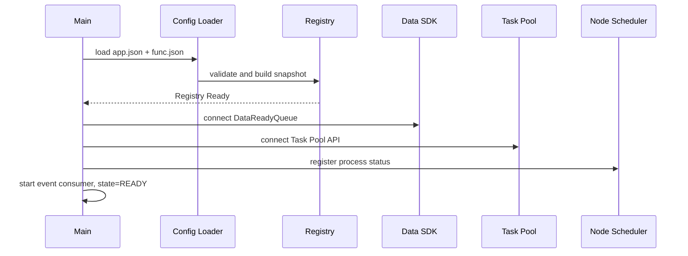

# 第三部分：接口与协作设计（第 11～14 章）

## 第 11 章 公共数据结构与接口协议

### 11.1 公共基础类型

所有对外结构体均包含 abi_version 和 struct_size。字符串统一采用 pointer + length，不依赖 NUL 结尾作为唯一边界。所有时间统一使用单调时钟纳秒值；跨节点传输另附墙上时钟字段用于日志，不用于超时计算。

### 11.2 FunctionConfig / FunctionMeta

包含 function_id、so_path、handler_symbol、function_version、resource、execution。FunctionMeta 属于 RegistrySnapshot，只读且由 Registry 管理内存。

### 11.3 DirectDependency

包含 source_function_id、target_function_ids[]。source 唯一，目标集合无重复，目标必须存在于 Function Registry。

### 11.4 TriggerConfig / TriggerMeta

包含 trigger_id、type、bucket_id、target_function_id、input_mode、enabled。V0.3 type 只允许 IMMEDIATE。

### 11.5 DataReadyEvent

包含 event_id、schema_version、app_id、event_type、bucket_id、key、session_id、source_function_id、target_function_id（可选）、DataRef、write_version、commit_timestamp_ns 和 flags。

### 11.6 TaskAction

包含 route_kind（DIRECT 或 BUCKET_TRIGGER）、target_function_id、trigger_id、event_id、session_id、BucketKey、input_mode 和 DataRef。TaskAction 是临时结果，不直接跨进程持久化。

### 11.7 TaskDescriptor

包含 task_id、idempotency_key、config_generation、Function 执行元信息、事件上下文、DataRef 输入数组、资源要求、超时和优先级。结构字段详见附录 D。

### 11.8 TaskResource

至少包含 max_concurrency、memory_limit_bytes、cpu_weight。V0.3 的硬准入主要依赖 Task Pool 提供的 available_slots 和 queue_capacity。

### 11.9 TriggerResult

包含 event_id、matched_rule_count、generated_action_count、duplicate_count、rejected_count 和逐规则错误列表。

### 11.10 RouteResult

包含 task_id、selected_node、selected_pid、pool_id、status、retryable、queue_depth 和 error_code。

### 11.11 错误码

统一使用 SchedulerError 枚举，避免不同模块返回含义相同但数值不同的错误。建议错误码见附录 D。

### 11.12 所有权约定

每个指针字段必须标注 borrowed、owned 或 transferred。DataRef 的引用计数由 Data SDK 管理；TaskDescriptor 内部数组由当前所有者管理。接口返回后不得保留调用方栈内存指针。

## 第 12 章 上游接口设计：Data Bucket SDK

### 12.1 接口职责

Data SDK 管理共享内存对象的写入、Commit、Bucket/Key 索引和 DataReadyQueue。Scheduler 只消费标准事件和 DataRef。Data SDK 不直接构造 Task，也不做节点/进程/协程调度。

### 12.2 初始化接口

Data SDK 初始化时需要知道 Scheduler Process 的事件队列标识、协议版本和消费模式。队列连接成功后，才允许上游 Actor 写入会触发调度的对象。

### 12.3 数据写入成功事件通知

推荐顺序：
1. 申请共享内存对象。
2. 写入 Payload 和元数据。
3. 完成长度、校验和、版本等元数据。
4. 执行 Commit；使用 release 语义发布数据可见性。
5. 获得 DataRef 和唯一 event_id。
6. 将 DataReadyEvent 写入 DataReadyQueue。
7. 若队列写入成功，返回事件已发布；若队列满，保留待发布事件并返回 BACKPRESSURE，不得丢弃已 Commit 的数据事件。

Event Consumer 以 acquire 语义读取队列项，确保看到完整 Payload 和元数据。

### 12.4 销毁与引用接口

推荐提供 data_ref_validate、data_ref_retain、data_ref_release。retain/release 必须对跨进程访问安全，或由 Data SDK 提供等价 lease 机制。Scheduler 不得自行维护共享内存引用计数。

### 12.5 DIRECT 上下文传递

DataReadyEvent 必须携带 source_function_id。若采用显式 DIRECT 目标投递，携带 target_function_id；若不携带，Scheduler 根据 Dependency Registry 对 source 做 fan-out。

### 12.6 Bucket、Key、Session 规范

逻辑唯一键为 app_id + bucket_id + session_id + key + generation。key 允许重复出现在不同 Session；同一逻辑键覆盖写入时必须通过 generation/write_version 区分新旧对象。

### 12.7 DataRef 接口契约

DataRef 至少含 owner_node_id、region_id、offset、length、generation、object_id 和 access_flags。不得把本进程虚拟地址放进跨进程事件。目标进程通过 Data SDK 的 map/read 接口取得本地地址。

### 12.8 共享内存数据可见性

Data SDK 必须保证“Payload 写完并 Commit”先于“DataReadyEvent 发布”。事件发布前不允许消费者读取未完成对象。若 Data SDK 采用共享内存环形队列，需要明确生产者发布序列和消费者 acquire 语义。

### 12.9 数据引用生命周期

DataReadyEvent 入队前由 Data SDK 持有基础引用；Scheduler 消费后为每个生成的 Task retain 一份引用。事件确认后释放事件本身的引用。Task Pool 接收 Task 后接管 Task 引用，执行完成后释放。详细状态见附录 D。

### 12.10 通知失败与返回值

队列满、队列不可用、协议版本不兼容、DataRef 无效都必须可见。已 Commit 但事件未成功发布时，Data SDK 必须保留可重试记录，不能把它当成成功完成。重试使用原 event_id。

### 12.11 上游调用示例

```c
data_ref_t ref;
data_ready_event_t event;

status = data_sdk_put_and_commit(bucket, key, session, payload, payload_len, &ref);
if (status != DATA_SDK_OK) {
    return status;
}

event = make_data_ready_event(ref, source_function, session);
status = data_sdk_publish_ready_event(&event);
if (status == DATA_SDK_BACKPRESSURE) {
    /* Keep the same event_id and retry; do not discard committed data. */
}
```

### 12.12 对上游团队的能力要求

- 提供稳定 DataRef 和对象 generation。
- 保证 Commit-before-notify。
- 提供 retain/release 或等价 lease。
- DataReadyQueue 满时可回压、重试且不丢事件。
- 明确事件队列是 MPSC 还是 MPMC、单消费者还是多消费者。
- 明确跨节点 DataRef 能否解析；若不能，Node Scheduler 必须做数据本地路由。
- 明确 Bucket/Key/Session 的编码、长度和字符集约束。

## 第 13 章 下游接口设计：Task Coroutine Pool

### 13.1 接口职责

Task Coroutine Pool 拥有 TaskQueue、工作协程和执行生命周期。Scheduler 只调用公开提交接口，不直接操作队列内存或唤醒原语。

### 13.2 Task 提交接口

推荐提供 task_pool_try_submit(pool, task, result)。该接口应在一个原子操作语义下完成容量检查、入队和唤醒尝试。返回 ACCEPTED 表示任务已被池接管；没有可唤醒协程不影响 ACCEPTED。

### 13.3 队列容量及资源准入

Task Pool 提供 queue_capacity、queue_depth、available_slots、running_tasks、pool_state。状态查询仅用于预选；try_submit 才是最终准入依据，避免并发竞争导致超卖。

### 13.4 入队与协程唤醒契约

入队成功后 Pool 尝试唤醒一个等待协程；若所有协程正在运行，Task 保留在队列，后续 Worker 完成任务后自行取队列。Scheduler 不得因为“当前没有睡眠协程”而判定入队失败。

### 13.5 TaskDescriptor 所有权转移

- ACCEPTED：Task Pool 接管 TaskDescriptor 及其中 DataRef 的引用。
- QUEUE_FULL / STOPPING / INVALID：Task Pool 不接管，Scheduler 保留所有权并释放。
- API 不得出现“已入队但返回失败”的不确定状态。
- 若下游采用异步提交，必须提供唯一 submission_id 和明确确认回调。

### 13.6 SO 加载及 Handler ABI

Pool 根据 so_path 加载 SO，查找 handler_symbol，校验 ABI 版本后调用 Handler。加载失败、符号不存在、ABI 不兼容都应产生 Task 执行失败事件，并按契约释放 DataRef。

### 13.7 输入数据还原

Pool/Task SDK 根据 TaskDescriptor 中 DataRef 调用 Data SDK map/read 接口。VALUE 和 KEY_AND_VALUE 模式允许读取数据；KEY_ONLY 模式只向业务 Handler 暴露 Key 元数据。

### 13.8 执行结束与资源释放

成功、失败、超时、取消均必须走统一完成路径。Pool 释放 TaskDescriptor 持有的 DataRef，更新进程可用槽和任务状态，并向观测接口上报结果。

### 13.9 下游调用示例

```c
task_pool_submit_result_t result;
task_pool_status_t status =
    task_pool_try_submit(pool, task_descriptor, &result);

if (status == TASK_POOL_ACCEPTED) {
    /* Ownership of task_descriptor transfers to the pool. */
} else {
    /* Ownership remains with Scheduler; Scheduler destroys the task. */
}
```

### 13.10 对下游团队的能力要求

- 原子 try_submit，明确所有权转移。
- 队列满和 Pool STOPPING 有独立返回码。
- 成功入队后尝试唤醒一个工作协程。
- 无可唤醒协程时任务仍留在队列。
- 公开进程级容量和队列统计。
- SO 加载失败、Handler 错误和 Task 完成均可观测。
- 统一负责 Task 结束时 DataRef 释放，避免 Scheduler 与 Pool 双重释放。

## 第 14 章 关键业务场景及完整时序

### 14.1 系统启动及配置注入



### 14.2 ImmediateTrigger 生产消费链路

```mermaid
sequenceDiagram
    participant Actor
    participant SDK as Data SDK
    participant Queue as DataReadyQueue
    participant ET as Event Trigger
    participant TB as Task Builder
    participant Router as Task Router
    participant Pool as Task Coroutine Pool
    participant Worker as Coroutine
    Actor->>SDK: write payload
    SDK->>SDK: commit shared-memory object
    SDK->>Queue: publish DataReadyEvent
    Queue->>ET: consume committed event
    ET->>ET: match ImmediateTrigger by bucket
    ET->>TB: emit TaskAction
    TB->>TB: retain DataRef and build TaskDescriptor
    TB->>Router: submit TaskDescriptor
    Router->>Pool: try_submit
    Pool->>Pool: enqueue and try wake one
    Pool-->>Worker: wake signal (if waiter exists)
    Worker->>Pool: pop Task
    Worker->>Worker: load SO and call Handler
```

### 14.3 DIRECT 一对一

源函数输出事件携带 source_function_id；Dependency Registry 查到唯一 target；Task Builder 生成一个 TaskDescriptor；Router 完成三级调度。此路径不经过 ImmediateTrigger 匹配。

### 14.4 DIRECT 一对多

同一 DataRef 被 fan-out 到多个目标。Task Builder 为每个目标生成独立 Task，并为每个 Task retain 一份引用。逐目标提交，返回成功/失败清单；失败目标不得影响已成功入队 Task 的所有权。

### 14.5 DIRECT 指定目标函数

如果事件携带 target_function_id，必须校验其属于 source 的依赖集合。不属于时返回 DEPENDENCY_TARGET_MISMATCH，不允许绕过配置直接执行任意 Function。

### 14.6 Trigger 未命中

Bucket 不存在或无启用 ImmediateTrigger 时，不生成 Task。记录 NO_TRIGGER_MATCH 作为正常未命中结果，不应当作系统异常。

### 14.7 同一 Bucket 多 Trigger

Event Trigger 按稳定顺序匹配所有规则。每条规则独立生成 TaskAction。TaskBuilder/Router 对每个 Action 分别处理并汇总结果。

### 14.8 DIRECT 与 Bucket Trigger 混合流水线

producer → processor 的 DIRECT 边用于明确的直接下游关系；processor 的输出可写入另一个 Bucket，再由该 Bucket 的 ImmediateTrigger 触发后续任务。混合指的是流水线不同阶段使用两种机制，不表示同一事件默认同时走两条路径。

### 14.9 队列满负荷

Pool try_submit 返回 QUEUE_FULL，Task 所有权不转移；Router 释放当前 TaskDescriptor 的 DataRef，并把可重试结果回传 Event Consumer。上游以相同 event_id 重试或按约定进入待处理队列。禁止把队列满伪装成提交成功。

### 14.10 节点容量不足

Node Scheduler 无可用节点时返回 NO_NODE_CAPACITY。若 DataRef 仅可本节点读取，则返回 NO_DATA_LOCAL_CAPACITY；若 Data SDK 支持远程访问，才允许选择远程节点。

### 14.11 进程容量不足

节点已选中但没有可接收进程时返回 NO_PROCESS_CAPACITY。不得直接把 Task 写入某个进程的内部队列绕过容量准入。

### 14.12 部分投递成功

一对多 fan-out 时逐目标提交。结果需要包含每个 target 的 Task ID、状态和错误码。已 ACCEPTED 的 Task 不回滚；未 ACCEPTED 的 Task 由 Scheduler 清理并可重试。

### 14.13 系统退出与资源释放

停止接收新事件；等待当前 Event Trigger handler 完成；对未提交 Task 释放引用；已提交 Task 的生命周期由 Pool 接管；最后断开 Data SDK 和 Node Scheduler。不得在 Pool 仍执行 Task 时提前释放其 DataRef。
