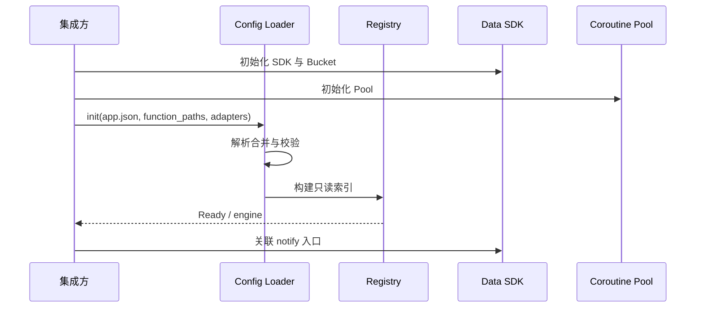
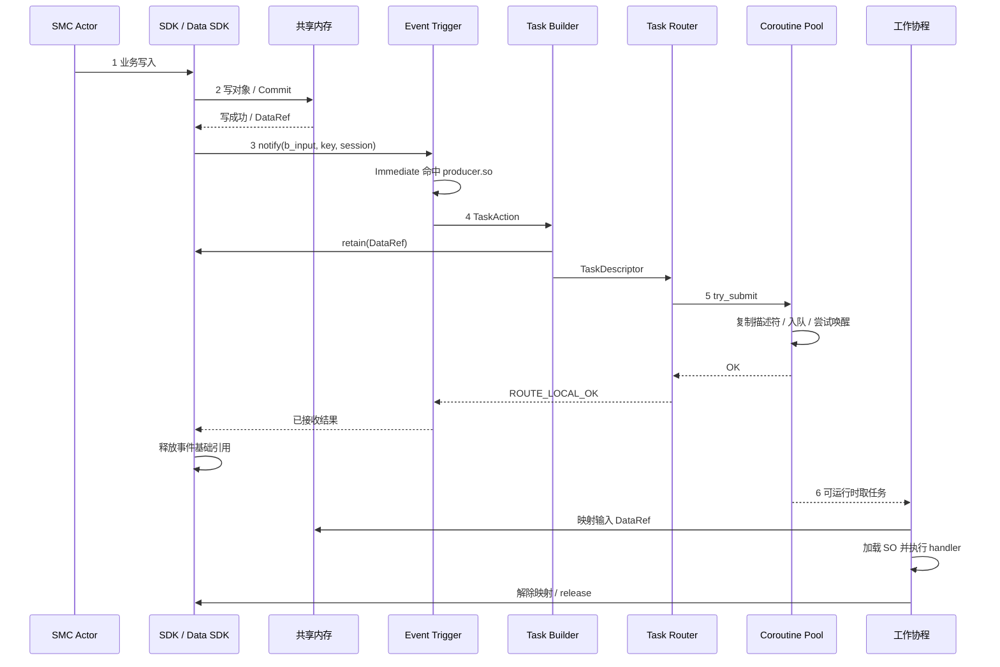
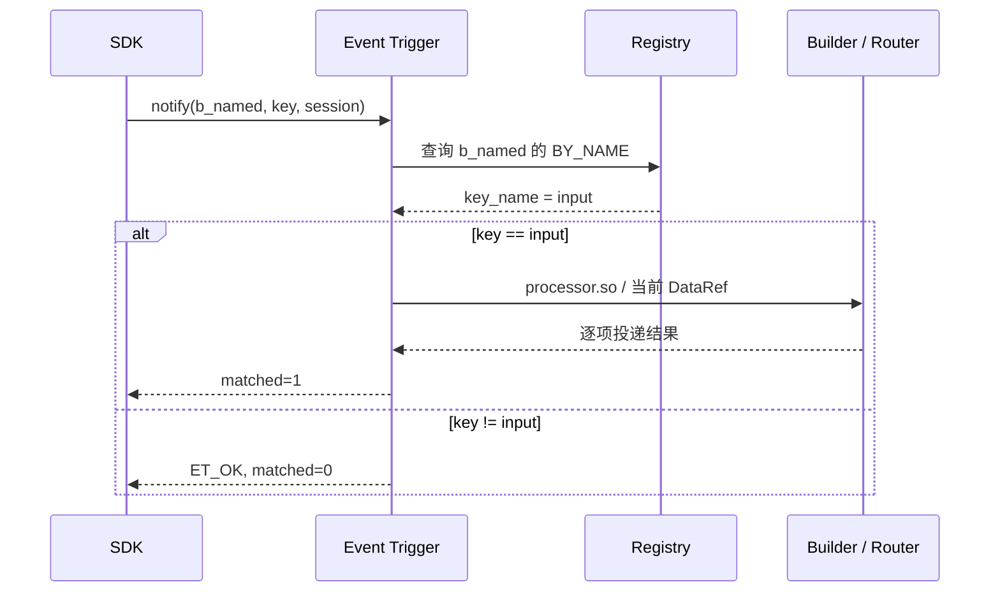
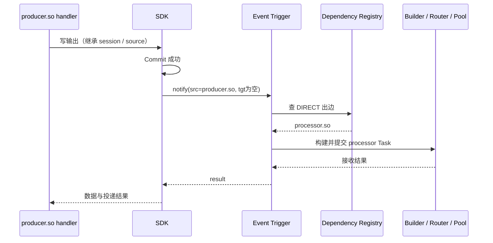
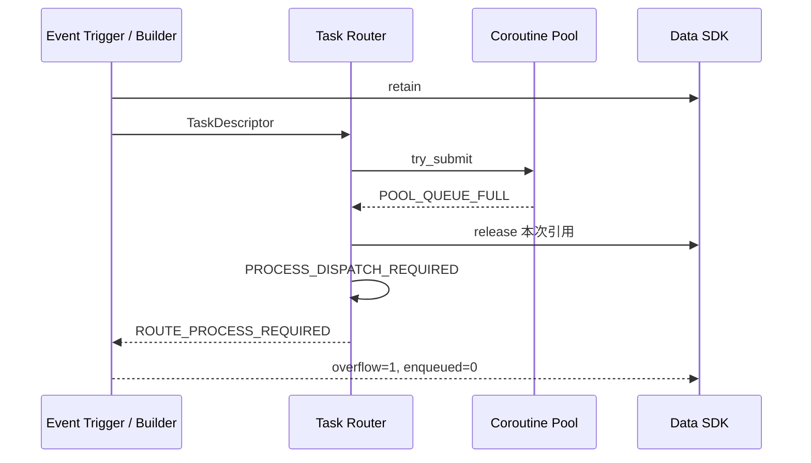

# 第三部分：接口与协作设计（第 11～14 章）

[返回主文档](V0.4-完整软件设计方案.md) · [公共头文件](examples/task_scheduler.h)

## 第 11 章 公共数据结构与接口协议

### 11.1 公共基础类型

统一 C11 类型、固定容量字符串与数组；使用 uint64_t 事件和任务 ID、size_t 数组容量。字符串为 NUL 结尾的字节序列，输入必须校验，拒绝截断。DataRef 采用 SDK 不透明值的推荐占位 ABI（见附录 C），实际含义由 Data SDK 定义；不传借用的业务指针。当前仅进程内 ABI，不定义网络序列化。

### 11.2 FunctionConfig、DirectDependency、TriggerConfig

FunctionConfig 包含 name、so_path、entry、version、resource、execution（描述另存配置侧）。DirectDependency 为 src→targets 邻接表。TriggerConfig 记录 bucket、trigger_name、primitive type、目标函数索引、option 和 key_name；三类 Registry 在 init 后不可变。内部索引不是外部 ABI。

### 11.3 DataReadyEvent

| 字段 | 含义 |
|---|---|
| event_id | SDK 非零唯一事件 ID |
| app_name | 应用标识，须与 engine 一致 |
| bucket / key / session_id | 对象逻辑身份 |
| src_function | 当前任务 name；外部 Actor 为空 |
| tgt_function | 可选显式 DIRECT 目标 |
| object_version / data_size | 数据版本与字节长度 |
| data_ref | SDK 可 retain 的已提交引用 |

通知入口只接受写成功事件，不另设未完成事件类型。SDK validate 必须校验 data_ref、version、size 与实际对象一致；同 key 覆盖不允许旧引用悄悄指向新对象。版本号为 0 仅当 SDK 采用不可变唯一引用并在冻结时约定。

### 11.4 TaskAction 与 TaskDescriptor

TaskAction 为内部栈上数据，包含 source_type、target、trigger_name、input_mode、event 借用指针。TaskDescriptor 包含 task_id、event_id、app_name、task_name、so_path、entry、version、resource、execution、source_type、src_function、trigger_name、单个 task_input_t。task_input_t 固化 bucket/key/session、object_version/data_size、data_ref、input_mode。任务描述符按值复制，不保留栈地址或 Registry 指针。

### 11.5 资源及执行信息

task_resource_t 与 task_execution_t 使用第 5 章的字段和单位；配置保留不等于运行时强制执行。Pool 只需满足已冻结的准入契约，额外元信息提供给下游按其能力使用。

### 11.6 TriggerResult、RouteResult 与错误码

调用者预先提供 trigger_result_t.items 与 capacity；notify 写入 count 和 matched/enqueued/overflow/failed。每个 item 带目标、规则、source_type、task_id（未生成时 0）、status（构建状态）和 route（未路由时 ROUTE_NOT_ATTEMPTED）。ET_OK 下 count=matched=enqueued+overflow+failed，零匹配为成功。ET_ERR_RESULT_CAPACITY 时 count=需要的数量，未进行投递；其他事件级失败 count=0。RouteResult 枚举及错误码见附录 D。

### 11.7 公开 API

```c
int event_trigger_init(event_trigger_t **out,
                       const char *app_config_path,
                       const char *const *function_paths,
                       size_t function_count,
                       const scheduler_adapters_t *adapters);
int event_trigger_notify(event_trigger_t *engine,
                         const data_ready_event_t *event,
                         trigger_result_t *result);
void event_trigger_destroy(event_trigger_t *engine);
```

init 成功发布 engine，失败 *out=NULL；函数级文件列表可为空。适配器按值保存，ctx 由调用方持有，SDK/Pool 回调应线程安全并保证生命周期。notify 同步返回投递结果，不等待执行；destroy 前由集成方停止通知并等待在途调用完成。公开类型以附录 C 及头文件为准。

## 第 12 章 上游接口设计 — Data Bucket SDK

### 12.1 接口职责和调用关系

SDK 写入并 Commit 共享内存；确认成功才通知 Event Trigger。SDK 保证写入可见性、对象标识和引用生命周期；Scheduler 不分配数据、不扫描 Bucket。默认直接调用 notify，若上游已有共享内存事件队列，由 SDK/集成方消费后调用相同 API；不新增事件队列线程。

### 12.2 初始化和注册

先初始化 Data SDK 及 Pool，准备 app 声明的 Bucket（及使用 DIRECT 时的 direct_invoc），将 data_ctx、validate、retain、release 与池回调传入 init，成功后 SDK 关联 engine。配置只声明逻辑 Bucket，不实际创建对象或内存池。

### 12.3 Commit-before-notify

1. SDK 分配对象并写入 Payload、长度及版本。
2. SDK Commit，保证数据写完且对消费者可见。
3. SDK 持有基础引用，构造 DataReadyEvent。
4. 调用 notify（同步），处理返回值和逐项结果。
5. SDK 在 notify 返回后释放本次基础引用；若业务需要补偿，可自行延长持有。已入队任务有各自独立引用。

若通过已有事件队列，生产者发布和消费者获取必须由该队列提供 release/acquire 或等价同步；事件项持有基础引用直到 notify 完毕。不要求 SDK 实现持久事件日志或 ACK/replay 框架。

### 12.4 DIRECT 上下文

外部 Actor 的 src_function/tgt_function 为空；执行中的 handler 使用 TaskContext，SDK 从中继承 app/session/source function，显式目标由 SDK 输出接口可选参数传入。不能使用进程全局 current_function；多个协程并发时会串上下文。DIRECT 的默认输出 Bucket 可约定 direct_invoc，普通 Bucket 也可用于 DIRECT 源输出，路由优先级不变。

### 12.5 DataRef 契约

| 能力 | 接口要求 |
|---|---|
| validate | 检查事件引用、对象版本和长度；不产生额外引用 |
| retain | 成功增加一份独立持有；失败不增加 |
| release | 对每份成功 retain 恰好一次，线程安全且不可失败的契约 |
| map / unmap | 下游执行时映射和解除映射，不改变持有计数；Scheduler 不调用 |
| 数据可见性 | Commit happens-before notify 与下游读取 |
| 版本隔离 | 不允许已被持有的对象被回收、覆盖成其他版本 |

DataRef 推荐为不透明固定大小值（示例 token），不是共享内存裸地址；实际结构、长度单位和零长度对象行为待冻结。validate 不替代 retain；SDK 基础引用保证两者间不会被回收。

### 12.6 结果处理

写入失败：不通知。写入成功但 notify 返回错误或有未入队项：数据写入成功与调度失败必须分别报告。ET_ERR_RESULT_CAPACITY 不产生投递副作用，可扩容重调；ET_OK + 部分成功不能盲目重放整个事件。队列满无自动重试，业务可按明确结果补偿。SDK 不必回滚已 Commit 对象，不能宣称所有 Task 已执行。

### 12.7 C 对接示例

```c
/* SDK 已成功 Commit，并持有 event.data_ref 的基础引用 */
trigger_item_result_t items[16];
trigger_result_t result = {.items = items, .capacity = 16};
int rc = event_trigger_notify(engine, &event, &result);
if (rc == ET_ERR_RESULT_CAPACITY) {
    /* result.count 为所需容量；尚未投递任何 Task */
    /* 调用方可扩容后再次 notify。 */
} else if (rc != ET_OK) {
    /* 报告事件级失败，不等于数据写入失败 */
} else if (result.enqueued != result.matched) {
    /* 查看每个 items[i]，报告未接收目标；不盲目重放 */
}
/* SDK 按本次基础引用的所有权约定释放。 */
```

上游完整能力要求：稳定的已提交对象引用、事件唯一 ID、正确 app/Bucket/Key/Session、当前任务来源及可选目标、validate/retain/release、提交后可见性、错误回传。SDK 的实际写入 API 不在本模块实现。

## 第 13 章 下游接口设计 — Task Coroutine Pool

### 13.1 职责与最小接口

协程池团队拥有 TaskQueue、工作协程、SO 加载与执行、结束清理。本模块仅依赖：
```c
pool_submit_result_t (*try_submit)(void *pool_ctx, const task_desc_t *task);
```
Pool 必须在函数返回前完成描述符按值复制和所有权确定。若下游实际提供 enqueue 和 wake_one 两个函数，Adapter 将它们组合为等价契约；不在 Scheduler 实现队列或唤醒原语。

### 13.2 原子准入及返回值

| 返回 | 已入队？ | 数据引用归属 |
|---|---|---|
| POOL_SUBMIT_OK | 是（可能已经开始/完成执行） | Pool |
| POOL_QUEUE_FULL | 否 | Router 释放 |
| POOL_NOT_READY | 否 | Router 释放 |
| POOL_RESOURCE_UNAVAILABLE | 否 | Router 释放 |
| POOL_INVALID_TASK | 否 | Router 释放 |
| POOL_INTERNAL_ERROR | 否 | Router 释放 |

try_submit 不能等待队列腾出容量，也不能出现已入队但报失败的状态。只要队列能接收且池允许，工作协程全忙也可以入队。额外资源判断如有则由 Pool/Adapter 原子提供；不先用非原子 queue_size 判定再直接写队列。

### 13.3 协程唤醒

成功入队后尝试唤醒一个等待协程；无人等待时任务保留，已忙协程完成后可继续取任务。等待与入队需要池内部同步保证不丢唤醒。唤醒尝试不改变入队成功事实。任务的执行顺序、并发数、线程绑定、池内部资源管理均不由本模块规定。

### 13.4 Task 加载、数据消费和结束

池取出自己保存的描述符，加载 /dev/shm/tasks/<name> 并查找 handler；按 input_mode 映射 DataRef，构造借用的 TaskContext；调用 handler；成功/失败/取消统一解除映射、释放已接管的引用和描述符。SO 缺失、加载错误、符号缺失、映射失败均为执行失败（已入队不撤销），必须释放引用。KEY_ONLY 无需映射，不向 handler 提供 value。

### 13.5 Handler ABI、资源与完成反馈

推荐 int handler(const task_context_t *ctx)，ABI 待冻结。resource/execution 可作为下游决策输入，但本期不强制其全部执行策略。Pool 自行记录执行状态；本期 Router 不订阅执行完成、不维护任务状态服务。日志可用 task_id/event_id 串联；取消/超时机制若 Pool 已有按其契约，Scheduler 不实现强制终止。

### 13.6 接口对接要求

原子非阻塞 try_submit、明确是否接收、完整复制描述符、成功接管引用、拒绝不持有、入队后 wake_one、无等待者不失败、执行/取消后释放，以及实际 handler ABI 与 Data SDK 读写接口。需验证 /dev/shm 可执行映射及 SO 路径。第 20 章提供契约测试。

## 第 14 章 关键业务场景及完整时序

### 14.1 系统启动



### 14.2 外部 Actor + Immediate



执行可能与 notify 返回并发；图中工作协程开始位置只表达因果依赖，不强制等待通知返回。

### 14.3 ByName 命中/未命中



### 14.4 DIRECT 一对一与链式



DIRECT 不等 producer handler 返回；下一段 Task 若继续产生数据且有 DIRECT 出边则重复上述链路。

### 14.5 DIRECT 扇出、显式目标与优先级

当配置 A→B,C 时，未指定目标生成 B 和 C；指定 C 只生成 C；指定未注册或不在出边集的 D 返回 ET_ERR_INVALID_DEPENDENCY，零投递。即使 A 输出的 Bucket 有 Immediate/ByName 规则，也不进入 Bucket 路径。另一无 DIRECT 的源或外部 Actor 写同 Bucket 时仍按规则匹配。多源边不是汇聚。

### 14.6 混合流水线

外部 Actor 写 b_input → Immediate producer → producer 写 direct_invoc → DIRECT processor；外部 Actor 也可写 b_named/input → ByName processor。若业务后续有 collector，可由无 DIRECT 的 processor 写普通 Bucket 触发它；同一事件不双路分发。

### 14.7 同 Bucket 多规则

同 Bucket 同时配置两个 Primitive，分别匹配；命中两条产生两个独立 Task，即使目标函数相同也各 retain 一份，不按目标合并。若其中一条失败，不撤销另一条成功项。

### 14.8 队列满和其他拒绝



不实际跨进程，不缓存任务，不返回成功接收。POOL_NOT_READY 等其他拒绝不打印进程间分发日志，仅返回各自错误。

### 14.9 部分成功与退出

一对多或多规则事件，若第一项已接收而第二项满队列，结果 matched=2,enqueued=1,overflow=1,failed=0；第一份引用由 Pool 释放，第二份由 Router 释放，SDK 处理事件基础引用。退出前停止通知、等待在途调用完成、销毁 engine；池中已接收 Task 不依赖 Registry，SDK 引用服务仍须存活至池清理完成。
