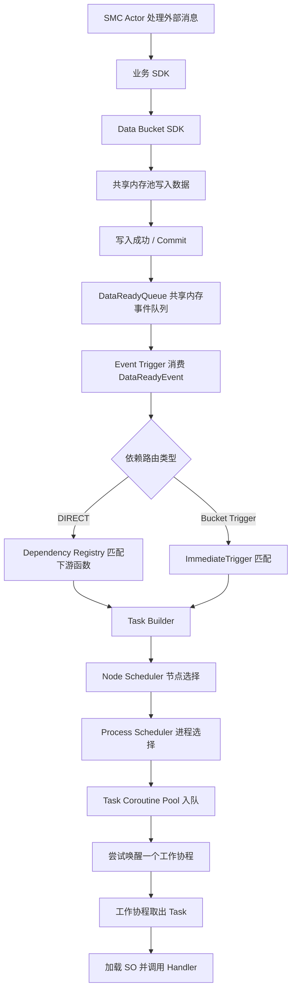
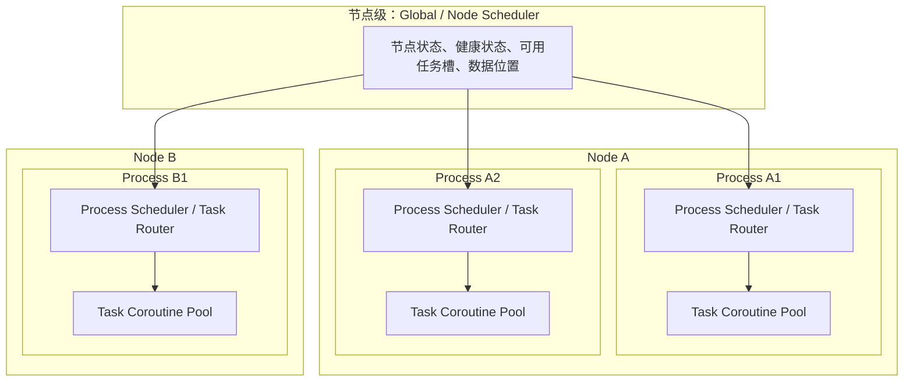

# Pheromone-mini V0.3 完整软件设计方案

> 版本：V0.3  
> 文档状态：设计评审基线  
> 日期：2026-11-25  
> 参考项目：MincYu/pheromone  
> 参考源码版本：4d22677aa20dd94069da06d47ec2608504bf6bf4

## 1. 文档目的

本文是 Pheromone-mini V0.3 的唯一主设计文档。它定义本期调度与 Trigger 模块的职责边界、整体架构、核心数据结构、配置协议、上下游接口、关键时序、工程实现和验收要求。本文与五份章节文档、四份附录共同构成完整设计基线。

本方案不是对 Pheromone 全量功能的移植。目标是从 Pheromone 中提取数据驱动调度的关键机制，按当前 Demo 的真实业务链路做最小实现，并将 Pheromone 的两级调度思想拆分为本项目的节点、进程、线程三级调度。

## 2. V0.3 设计结论

### 2.1 本期必须遵守的原则

1. **数据驱动，而非轮询扫描。** 数据写入成功后，由 Data SDK 发布 DataReadyEvent，Event Trigger 根据预先注入的规则判断是否生成 Task。
2. **Data Bucket 与任务队列是两种不同对象。** Data Bucket 保存数据及其引用；DataReadyQueue 传递“数据已就绪”事件；TaskQueue 保存待执行任务。三者不能混用。
3. **DIRECT 与 Trigger 分离。** DIRECT 是显式函数依赖边，ImmediateTrigger 是 Bucket 数据到达条件。二者有不同的配置、匹配和分发路径。
4. **本期只实现 ImmediateTrigger。** Pheromone 的 ByName、BySet、ByBatchSize、ByTime 等能力仅作为源码调研结果和未来扩展点，不纳入本期实现。
5. **数据不经过 Scheduler 拷贝。** Scheduler 只传递 DataRef 和元数据；共享内存对象的创建、映射、索引、引用计数和释放由 Data Bucket SDK 负责。
6. **执行器不由 Scheduler 实现。** Task Coroutine Pool 负责队列、协程唤醒、SO 加载和 Handler 执行；Scheduler 通过稳定接口提交 TaskDescriptor。
7. **三级调度职责分离。** 节点级选择目标节点，进程级选择目标进程，线程/协程级由 Task Coroutine Pool 完成队列接收和工作协程唤醒。
8. **失败必须可回传。** 队列满、资源不足、DataRef 失效、配置缺失等均返回明确错误，不允许静默丢任务或泄漏引用。

### 2.2 本期实现范围

| 能力 | 本期级别 | 说明 |
|---|---|---|
| 配置加载与校验 | P0 | 启动加载 app.json、func.json，构建只读 Registry |
| Function Registry | P0 | 函数元信息、SO 路径、Handler、资源和执行配置 |
| DIRECT 依赖 | P0 | 一对一、一对多、指定目标校验 |
| Data Bucket 事件接入 | P0 | 消费 Data SDK 发布的 DataReadyEvent |
| ImmediateTrigger | P0 | 每个匹配的成功写入事件立即生成 TaskAction |
| Task Builder | P0 | 还原静态函数信息和动态数据引用 |
| 节点级调度 | P0 | 节点健康、容量和数据位置感知的节点选择 |
| 进程级调度 | P0 | 进程容量准入，优先复用已加载目标函数的进程 |
| 线程/协程级调度 | P0 | 通过 Task Pool API 入队并触发唤醒 |
| DataRef 生命周期 | P0 | retain、transfer、release 契约 |
| 事件去重 | P0 | 基于 event_id 的进程内有界去重；不宣称跨重启 exactly-once |
| 动态增删 Trigger | P1 | 本期静态配置；后续可做版本化 Registry 快照 |
| 多种 Trigger Primitive | 预留 | 仅 ImmediateTrigger 可用 |
| 持久化事件日志、分布式事务 | 不做 | 不属于预研 Demo 最小范围 |

### 2.3 与 Pheromone 的关系

Pheromone 源码采用 Coordinator + Local Scheduler 的两级调度；本项目将其职责拆成 Node Scheduler + Process Scheduler + Task Coroutine Pool。前两层分别继承全局节点选择和本地执行资源选择思想，第三层是针对本项目协程池执行模型增加的线程级分发层。不能把 Pheromone 描述成原生三级调度。

Pheromone 原始实现是 C++。本项目以其行为和协议语义为参考，按本项目要求使用 C11 核心实现和 C ABI，不直接复制 C++ 类层次。

## 3. 整体业务链路

### 3.1 三级调度结构

| 层级 | 组件 | 输入 | 决策 | 输出 |
|---|---|---|---|---|
| 节点级 | Node Scheduler | TaskDescriptor、NodeStatus、DataRef 所在节点 | 选择目标节点 | NodeRoute |
| 进程级 | Process Scheduler / Task Router | NodeRoute、ProcessStatus、TaskResource | 选择目标进程并做准入 | ProcessRoute |
| 线程/协程级 | Task Coroutine Pool | TaskDescriptor | 入队、唤醒可运行协程 | QueueAccepted / QueueFull |

节点级调度是全局视角；进程级调度是目标节点内的本地视角；线程/协程级由目标进程的协程池执行。对于单节点 Demo，Node Scheduler 可以退化为只返回本节点，但接口仍保留节点选择语义。

## 4. 软件模块

| 模块 | 主要职责 | 不负责 |
|---|---|---|
| Config Loader | 读取、解析、校验配置 | 运行时任务调度 |
| Function Registry | 保存 Function 静态元信息 | 加载 SO |
| Dependency Registry | 保存 DIRECT 源到目标的映射 | Trigger 匹配 |
| Trigger Registry | 保存 Bucket 到 Trigger 规则的映射 | 数据存储 |
| Event Trigger | 消费数据就绪事件、匹配 DIRECT / ImmediateTrigger | 分配共享内存 |
| Task Builder | 将 Action 与 Function 元信息合成为 TaskDescriptor | 执行 Task |
| Node Scheduler | 选择目标节点 | 进程内协程调度 |
| Process Scheduler / Task Router | 选择进程、准入、调用 Task Pool | 自行维护协程池内部队列 |
| Data SDK Adapter | 对接 DataRef 和事件队列 API | 管理共享内存池实现 |
| Task Pool Adapter | 对接协程池提交 API | 实现协程调度器 |

## 5. 21 章文档索引

| 部分 | 章节 | 内容 | 详细文档 |
|---|---:|---|---|
| 第一部分：总体设计 | 1 | 背景、目标、边界、术语 | [01-总体设计](01-总体设计.md) |
|  | 2 | Pheromone 源码参考与设计继承 | [01-总体设计](01-总体设计.md) |
|  | 3 | 总体架构、模块和生命周期 | [01-总体设计](01-总体设计.md) |
| 第二部分：核心模块详细设计 | 4 | Task 定义与执行规范 | [02-核心模块详细设计](02-核心模块详细设计.md) |
|  | 5 | JSON 配置协议 | [02-核心模块详细设计](02-核心模块详细设计.md) |
|  | 6 | Config Loader | [02-核心模块详细设计](02-核心模块详细设计.md) |
|  | 7 | Registry | [02-核心模块详细设计](02-核心模块详细设计.md) |
|  | 8 | Event Trigger | [02-核心模块详细设计](02-核心模块详细设计.md) |
|  | 9 | Task Builder | [02-核心模块详细设计](02-核心模块详细设计.md) |
|  | 10 | Task Router 与三级调度 | [02-核心模块详细设计](02-核心模块详细设计.md) |
| 第三部分：接口与协作设计 | 11 | 公共数据结构与协议 | [03-接口与协作设计](03-接口与协作设计.md) |
|  | 12 | Data Bucket SDK 上游接口 | [03-接口与协作设计](03-接口与协作设计.md) |
|  | 13 | Task Coroutine Pool 下游接口 | [03-接口与协作设计](03-接口与协作设计.md) |
|  | 14 | 关键场景及时序 | [03-接口与协作设计](03-接口与协作设计.md) |
| 第四部分：工程实现设计 | 15 | 并发与可靠性 | [04-工程实现设计](04-工程实现设计.md) |
|  | 16 | 性能设计 | [04-工程实现设计](04-工程实现设计.md) |
|  | 17 | 日志与可观测性 | [04-工程实现设计](04-工程实现设计.md) |
|  | 18 | C 工程结构与构建 | [04-工程实现设计](04-工程实现设计.md) |
| 第五部分：需求追踪与测试验收 | 19 | 完整功能需求清单 | [05-需求追踪与测试验收](05-需求追踪与测试验收.md) |
|  | 20 | 测试与验收方案 | [05-需求追踪与测试验收](05-需求追踪与测试验收.md) |
|  | 21 | 研发计划及待确认事项 | [05-需求追踪与测试验收](05-需求追踪与测试验收.md) |

## 6. 关键接口冻结顺序

1. Data SDK：先冻结 DataReadyEvent、DataRef、事件队列消费和引用持有/释放契约。
2. Task Coroutine Pool：冻结 TaskDescriptor ABI、try_submit 返回值、队列满语义和所有权转移。
3. Config：冻结 app.json / func.json 字段和配置版本。
4. Scheduler：冻结 DIRECT 与 ImmediateTrigger 的路由规则、三级调度返回码。
5. Demo：先单节点单进程跑通，再扩展多进程和多节点。

## 7. 设计限制与明确不承诺事项

- DataRef 是引用，不是可跨进程传递的裸指针；必须包含可定位和校验数据的句柄/偏移/代数信息。
- 共享内存只解决节点内数据共享；跨节点消费必须由 Data SDK 提供远程读取/转发能力，或由 Node Scheduler 限制为数据所在节点。
- 进程内去重不等于 exactly-once。若未来要求跨进程重启不丢不重，需要持久化事件日志和任务状态存储。
- Task Pool 入队成功只表示任务被接收，不表示任务已执行成功。
- SO 文件存在性可由配置加载阶段检查；SO 动态加载和 Handler 符号校验由 Task Coroutine Pool 执行阶段负责。
- 本文给出的 ABI 和 JSON Schema 是推荐冻结稿；标记“待接口冻结”的字段需要上下游确认后再作为正式契约。

## 8. 参考资料

- [Pheromone 原始仓库](https://github.com/MincYu/pheromone)
- [Pheromone 参考 commit](https://github.com/MincYu/pheromone/tree/4d22677aa20dd94069da06d47ec2608504bf6bf4)
- [Pheromone 源码映射与裁剪说明](appendix/A-Pheromone源码映射.md)
- [JSON 配置协议示例](appendix/B-JSON配置协议示例.md)
- [C 语言接口与 Task ABI](appendix/C-C接口与Task-ABI.md)
