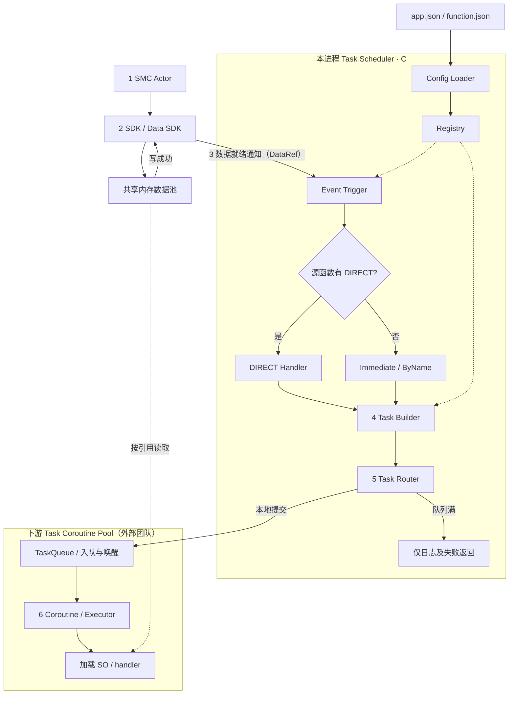

# Pheromone-mini V0.4 完整软件设计方案

版本 V0.4 | 2026-11-25 | 设计评审基线 | 语言 C11

## 1. 范围与决策

本方案完整替换 V0.3，覆盖五大部分、21 章。负责业务步骤 3、4、5；目标是最小可联调的单节点、单进程调度与 Trigger 模块，而非分布式调度框架。

| 项目 | V0.4 基线 |
|---|---|
| 调度 | 统一本进程 TaskQueue；下游原子容量判断、入队、尝试唤醒一个协程 |
| 队列满 | 记录 PROCESS_DISPATCH_REQUIRED，返回未接收；不执行 IPC、不另建等待队列 |
| 触发 | DIRECT 独立依赖路径优先；Immediate 与 ByName 两种 Bucket Primitive |
| 配置 | app.json + 可选单函数 function.json，保留附件字段及嵌套结构 |
| SO | /dev/shm/tasks/<name>（name 已含 .so），入口固定 handler，业务函数无状态 |
| 数据 | SDK 确认共享内存写成功后通知；Scheduler 只处理元数据和 DataRef |
| 执行 | 不实现协程池、任务队列、SO loader；由协程池团队实现 |
| 可靠性 | 明确所有权、逐目标投递结果；P0 不自动重试、不保证去重；有界去重 P1 |

删除 V0.3 的节点/进程选择、冷热实例调度、资源状态表、数据位置选择、心跳、网络传输及相应配置、代码目录和验收要求。原项目相关机制只作为源码研究记录（附录 A）。资源与 execution 属性继续保留，但不在本期实现复杂资源调度、强制配额、超时中断或线程亲和性策略。

## 2. 总体架构

说明：SDK→Event Trigger 默认采用同步 C 回调，若上游已有事件消息队列则由其适配后调用，不要求实现新队列。数据池和 TaskQueue 分属上下游。同步通知只等待投递结果，不等待任务执行。

## 3. 五大部分、21 章

| 章节 | 内容 | 文档 |
|---:|---|---|
| 1 | 项目背景与需求分析 | [总体](01-总体设计.md) |
| 2 | Pheromone 源码参考与继承 | [总体](01-总体设计.md) |
| 3 | 总体软件架构 | [总体](01-总体设计.md) |
| 4 | Task 定义与执行规范 | [模块](02-核心模块详细设计.md) |
| 5 | JSON 配置协议 | [模块](02-核心模块详细设计.md) |
| 6 | Config Loader | [模块](02-核心模块详细设计.md) |
| 7 | Registry | [模块](02-核心模块详细设计.md) |
| 8 | Event Trigger | [模块](02-核心模块详细设计.md) |
| 9 | Task Builder | [模块](02-核心模块详细设计.md) |
| 10 | Task Router | [模块](02-核心模块详细设计.md) |
| 11 | 公共数据结构与协议 | [接口](03-接口与协作设计.md) |
| 12 | Data Bucket SDK 接口 | [接口](03-接口与协作设计.md) |
| 13 | Task Coroutine Pool 接口 | [接口](03-接口与协作设计.md) |
| 14 | 关键场景及时序 | [接口](03-接口与协作设计.md) |
| 15 | 并发与可靠性 | [工程](04-工程实现设计.md) |
| 16 | 性能 | [工程](04-工程实现设计.md) |
| 17 | 日志与可观测性 | [工程](04-工程实现设计.md) |
| 18 | C 工程设计 | [工程](04-工程实现设计.md) |
| 19 | 功能需求清单 | [验收](05-需求追踪与测试验收.md) |
| 20 | 测试与验收 | [验收](05-需求追踪与测试验收.md) |
| 21 | 研发计划及待确认事项 | [验收](05-需求追踪与测试验收.md) |

## 4. 关键契约

- 配置以 app.json 为应用内函数清单和运行时拓扑的唯一来源；单函数文件按 name 补充/覆盖函数静态元数据，不能隐式新增依赖或 Trigger。
- DIRECT 按源函数判断：有边则指定合法目标或 fan-out 全部目标，不检查 Bucket Trigger；非法显式目标返回错误，不回退。没有边且无显式目标才查普通 Bucket。
- Task Builder 每个任务持有一个独立数据引用；池成功接收时复制完整描述符并接管引用，拒绝时不持有。
- 本期“资源足够”至少指池能够接收任务（原子准入）；如池能提供资源准入结果则透传，不能把 CPU/MEM 配置伪装成已强制执行的配额。
- handler 签名、DataRef 表示、真实池接口为待冻结草案；不能在签名未确认时宣称实际联调完成。

## 5. 变更与阅读入口

[文档导航](README.md) · [源码参考](appendix/A-Pheromone源码映射.md) · [JSON 协议](appendix/B-JSON配置协议示例.md) · [C ABI](appendix/C-C接口与Task-ABI.md) · [错误码](appendix/D-数据结构与错误码.md)。

V0.3 历史基线：[固定提交](https://github.com/10wvw01/Pheromone-mini/tree/06f21152de6be9cad18c1dc792a2fe3dc4b15069/docs)。V0.4 是当前独立完整版本，不依赖阅读 V0.3。
