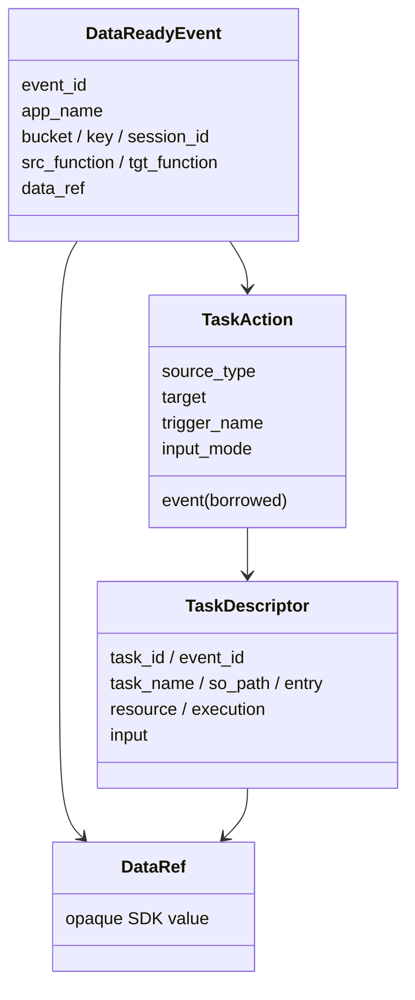
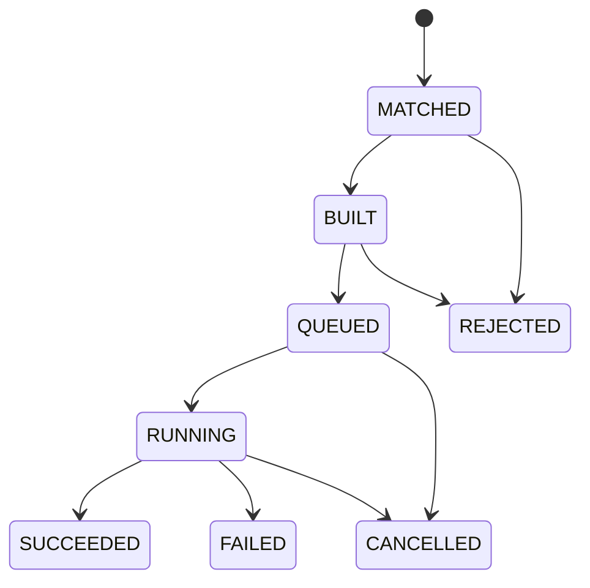

# 附录 D：数据结构、状态与错误码

以 [公共头文件](../examples/task_scheduler.h) 和第 11 章为对外契约草案。内部类型不构成外部 ABI。

## D.1 核心对象关系

内部 function_config_t 持有已规范化 name、so_path、entry、version、resource、execution；config model 保存 description。trigger_config_t 持有 type（TRIGGER_IMMEDIATE / TRIGGER_BY_NAME）、bucket、trigger_name、target、key_name、option。task_action_t 持有目标配置和 event 的借用指针；只在 notify 内有效。event_trigger_t 持有 Registry、scheduler_adapters_t 和原子 task_id 计数器。均由实现阶段定义在 private 头文件。

## D.2 DataRef 生命周期

| 阶段 | 持有方 | 处理 |
|---|---|---|
| 已 Commit，通知前 | SDK | 保持基础引用有效 |
| notify 匹配 | SDK | Event Trigger 借用基础引用，不释放 |
| 每项 Builder 成功 | Router | retain 一份 |
| Pool 接收 | Pool | 复制描述符，接管该份引用 |
| Pool 拒绝 | Router | release 本次 retain，池未接管 |
| notify 返回 | SDK | 根据 SDK 契约释放基础引用 |
| 执行完成/失败/取消 | Pool | 解除映射，release 每个接管引用 |

fan-out N 个 Task 时 N 次 retain，不共用一份计数；拒绝不会释放 SDK 的基础引用。TaskContext 和映射视图在 handler 返回后失效。已入队的描述符无 Registry 借用指针，engine 销毁不会直接使其失效；SDK 引用服务必须持续到所有池引用释放。

## D.3 对象所有权矩阵

| 对象 | 所有者 | 有效期 |
|---|---|---|
| Registry | engine | init 成功至 destroy |
| DataReadyEvent | SDK 调用者 | notify 返回前 |
| TaskAction | notify 栈 | 当前处理项 |
| TaskDescriptor 栈副本 | Builder/Router | try_submit 返回前 |
| TaskDescriptor 池副本 | Pool | 接收到执行清理 |
| TriggerResult.items | notify 调用者 | 调用者管理 |
| TaskContext | Pool | handler 调用期间 |
| SDK/Pool ctx | 各团队 | 覆盖所有回调及已接收 Task |

## D.4 事件级错误码

| 值 | 枚举 | 语义 |
|---:|---|---|
| 0 | ET_OK | 事件处理完毕，检查逐项结果 |
| -1 | ET_ERR_INVALID_ARGUMENT | 参数/格式非法 |
| -2 | ET_ERR_CONFIG | 配置加载或校验失败 |
| -3 | ET_ERR_UNKNOWN_APP | app 不匹配 |
| -4 | ET_ERR_UNKNOWN_BUCKET | 未声明普通 Bucket |
| -5 | ET_ERR_UNKNOWN_SOURCE | 非空源函数未注册 |
| -6 | ET_ERR_INVALID_DEPENDENCY | 显式目标无合法 DIRECT 边 |
| -7 | ET_ERR_DATA_REF | validate 或 retain 失败（retain 为单项错误） |
| -8 | ET_ERR_RESULT_CAPACITY | 结果容量不足，count=所需项数，未投递 |
| -9 | ET_ERR_NO_MEMORY | 初始化或构建内存不足 |
| -10 | ET_ERR_INTERNAL | 内部不变量破坏/ID 耗尽等 |

事件级校验或容量失败发生在任何投递前。构建失败则写入单项 status，route=ROUTE_NOT_ATTEMPTED，不将已发生的部分成功覆盖为事件级错误。init 失败 *out=NULL；notify 在 result 指针有效时重置输出计数（保留 items/capacity）。ET_ERR_RESULT_CAPACITY 仅 count 返回所需数，其他计数为 0。

## D.5 Pool 与 Router 状态

| Pool 返回 | Router 返回 | 已入队 | 计数 |
|---|---|---|---|
| POOL_SUBMIT_OK | ROUTE_LOCAL_OK (0) | 是 | enqueued |
| POOL_QUEUE_FULL | ROUTE_PROCESS_REQUIRED (1) | 否，仅日志 | overflow |
| POOL_NOT_READY / POOL_RESOURCE_UNAVAILABLE | ROUTE_POOL_UNAVAILABLE (2) | 否 | failed |
| POOL_INVALID_TASK | ROUTE_INVALID_TASK (3) | 否 | failed |
| POOL_INTERNAL_ERROR | ROUTE_ERROR (4) | 否 | failed |
| 未构建成功 | ROUTE_NOT_ATTEMPTED (5) | 否 | failed |

ET_OK 时 count=matched=enqueued+overflow+failed；item.status 是构建结果，构建成功为 ET_OK，最终是否接收由 item.route 决定。零匹配不是错误。部分成功不回滚。PROCESS_REQUIRED 不等于已经分发，所有失败均明确未接收。错误后的业务重试不自动执行。

## D.6 Task 状态与去重边界

本模块责任到 QUEUED；之后由 Pool 负责。P0 不存运行中/已完成任务表，也不保证事件去重。可选 P1 去重的键与 RESERVED/ACCEPTED 状态见第 15 章；未实施时不得宣传安全全量重放或 exactly-once。
