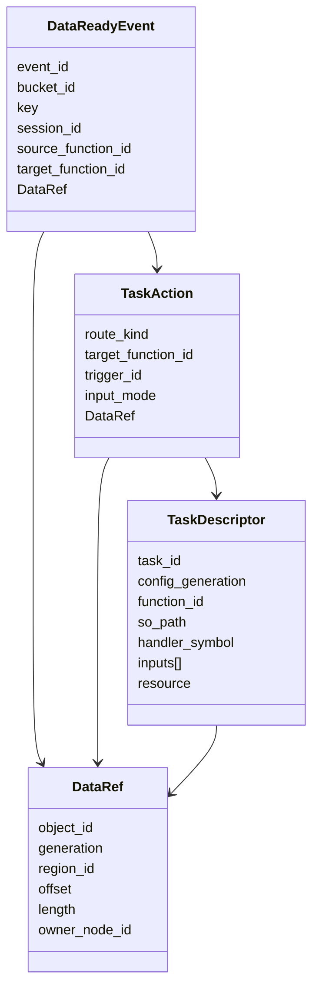
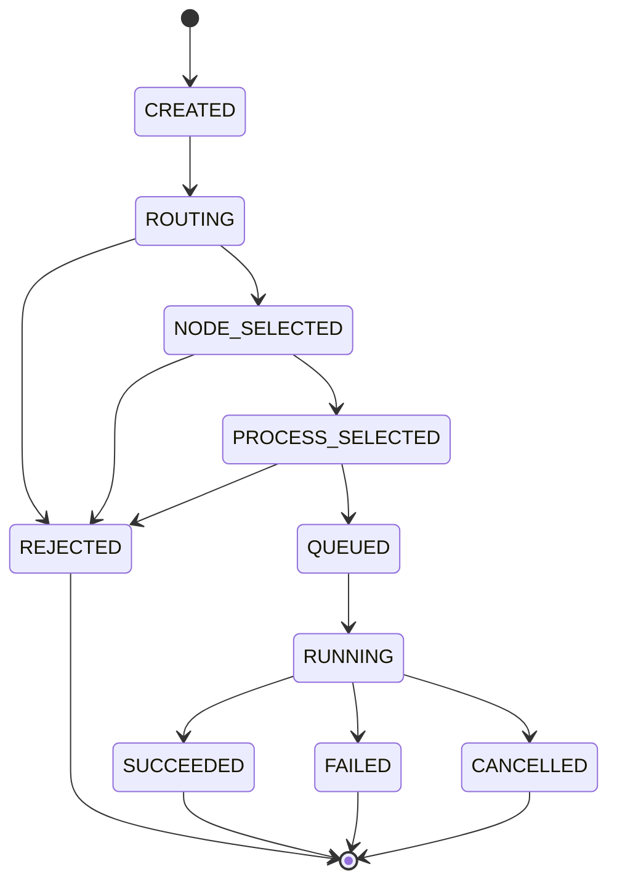

# 附录 D：数据结构、状态与错误码

## D.1 核心数据对象关系

## D.2 DataRef 生命周期

DataRef 是共享数据对象的逻辑引用。引用计数必须由 Data SDK 管理，Scheduler 只调用 retain/release，不直接修改共享内存元数据。

| 阶段 | 持有方 | 动作 |
|---|---|---|
| 数据写入中 | Data SDK | 分配对象、写 Payload |
| Commit 成功 | Data SDK | 发布对象 generation 和 DataRef |
| DataReadyEvent 入队 | Data SDK / Event Queue | 保证事件可重试且引用有效 |
| Scheduler 消费事件 | Event Consumer | 校验 DataRef，按 Task 数量 retain |
| Task 构建成功 | Task Router | 持有 TaskDescriptor 及输入引用 |
| Pool 返回 ACCEPTED | Task Coroutine Pool | 接管 TaskDescriptor 和引用 |
| Pool 执行中 | Task Coroutine Pool | 保证引用不被回收 |
| Task 完成/取消 | Task Coroutine Pool | release 所有输入引用 |
| 投递失败 | Scheduler | 释放未转移引用 |

若一个事件生成 N 个 Task，Scheduler 必须为 N 个 Task 分别 retain。不能只 retain 一次再把同一个计数引用交给多个 Task。

## D.3 所有权矩阵

| 对象 | 创建方 | 使用方 | 释放方 |
|---|---|---|---|
| RegistrySnapshot | Config Loader | 全部 Scheduler 模块只读 | Scheduler 主生命周期 |
| DataReadyEvent | Data SDK | Event Trigger | Data SDK/队列协议确认 |
| DataRef 对象 | Data SDK | Scheduler / Task Pool | Data SDK |
| TaskAction | Event Trigger | Task Builder | Event Trigger 处理结束 |
| TaskDescriptor | Task Builder | Router → Pool | 当前所有者 |
| RouteResult | Router | Event Trigger / 日志 | 调用方 |
| TaskContext | Task Pool | Handler 借用 | Task Pool |

## D.4 Task 状态机

Scheduler 主要负责 CREATED 至 QUEUED；Task Pool 负责 QUEUED 至终态。若远程 Node Transport 尚未确认目标接收，任务状态应保持 ROUTING，不得提前标记 QUEUED。

## D.5 错误码建议

| 错误码 | 名称 | 是否可重试 | 含义 |
|---:|---|---|---|
| 0 | PM_OK | 否 | 成功 |
| 1 | PM_DUPLICATE_EVENT | 否 | 去重窗口内重复事件 |
| 2 | PM_NO_TRIGGER_MATCH | 否 | 无匹配 Trigger，正常未命中 |
| -1 | PM_ERR_INVALID_ARGUMENT | 否 | 参数为空或格式错误 |
| -2 | PM_ERR_CONFIG | 否 | 配置解析/校验失败 |
| -3 | PM_ERR_DATA_REF | 视情况 | DataRef 无效或过期 |
| -4 | PM_ERR_NO_DEPENDENCY | 否 | 显式 DIRECT 事件找不到依赖 |
| -5 | PM_ERR_DEPENDENCY_TARGET_MISMATCH | 否 | 指定目标不属于依赖集合 |
| -6 | PM_ERR_NO_NODE_CAPACITY | 是 | 无可用节点 |
| -7 | PM_ERR_NO_PROCESS_CAPACITY | 是 | 无可用进程 |
| -8 | PM_ERR_QUEUE_FULL | 是 | Task Pool 队列满 |
| -9 | PM_ERR_POOL_STOPPING | 是 | Task Pool 正在停止 |
| -10 | PM_ERR_NO_MEMORY | 是 | 内存分配失败 |
| -11 | PM_ERR_UNSUPPORTED_TRIGGER | 否 | 当前版本不支持该 Trigger |

实现时错误码需映射到模块内部更细的诊断原因，但对外保持稳定。

## D.6 去重键与边界

推荐去重键：
- DIRECT：event_id + source_function_id + target_function_id。
- ImmediateTrigger：event_id + trigger_id + target_function_id。

去重表只记录本进程已成功提交或正在提交的组合。失败提交应允许重试；并发提交时先占位，提交结果确认后更新状态。记录 TTL 和容量必须配置化。

该机制只能降低同一进程生命周期内的重复投递，不等价于持久化 exactly-once。若 Data SDK 会跨进程重放事件，仍需要持久化去重或 Task 状态服务。

## D.7 配置与运行状态

RegistrySnapshot 带 config_generation；TaskDescriptor 固化生成时的代数。配置升级后，新事件使用新代数，已构建 Task 继续使用旧版本的 SO/元信息，直到其完成。V0.3 通过重启加载配置，不实现在线切换。
